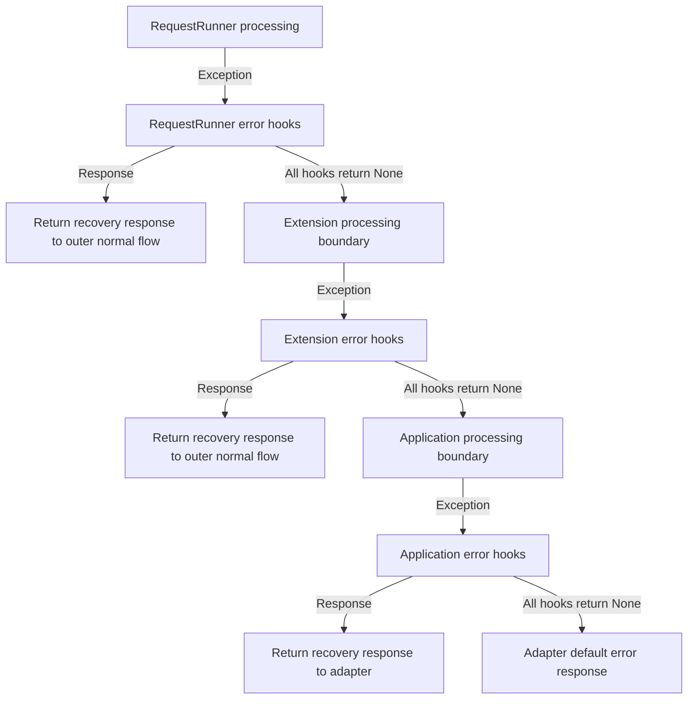

# Request Error Handling

[← Guide index](./README.en.md)

[한국어](./ErrorHandling.md)

This guide explains how to observe exceptions during HTTP request processing and recover with a custom `Response`. If an error hook returns a `Response`, that response becomes the result for the error. Returning `None` means the hook did not handle the error, so the exception proceeds to the next error hook or outer processing scope.

## Error handling boundaries

`RequestRunner`, `Extension`, and `Application` each provide error hooks for their request-processing scope. The innermost scope gets the first opportunity to handle an error. The exception reaches an outer scope only when the inner scope does not handle it.



Each error hook handles exceptions from its own scope. For example, if a route response hook fails, the `RequestRunner` error hook runs first. If it returns a `Response`, the original exception is considered handled and is not passed to the Application error hooks.

If the recovery response causes a new exception while an outer scope processes it normally, that new exception is passed to that outer scope's error hooks. The inner error hook that created the recovery response is not called again.

Failures before a `Request` is created do not enter Application request hooks. Serialization, network, and body-transmission failures after Application has returned a response to the adapter do not return to the Application error hooks. Startup and cleanup failures are lifecycle errors, separate from HTTP request errors. See [Application lifecycle](./Lifecycle.en.md) for lifecycle order.

## Error-hook contract

| Hook contract | Registration | Arguments | Return |
| --- | --- | --- | --- |
| `RequestRunnerRequestError` | `on_request_error` in a `RequestRunner` class declaration | `Request`, `Exception` | `Optional[Response]` |
| `ExtensionRequestError` | `on_request_error` in the `Extension` constructor | `Request`, `Exception` | `Optional[Response]` |
| `ApplicationRequestError` | `on_request_error` in the `Application` constructor or an extension's dynamic request-hook registration | `Request`, `Exception` | `Optional[Response]` |

Error hooks keep their existing `(request, error)` arguments. Register one hook or an ordered sequence.

| Return value | Meaning | Next action |
| --- | --- | --- |
| `None` | This hook did not handle the error | Run the next error hook in the same scope |
| `Response` | This hook handled the error as a response | Adopt it and stop the remaining error hooks in the same scope |
| Any other value | Contract violation | Raise `TypeError`; do not run later error hooks |

If all hooks in a scope return `None`, that scope re-raises the original exception. Hooks run in the configured order. With `[None, Response, sentinel]`, the first hook runs, then the second; the third is skipped.

The normal response hooks belonging to the scope where the error occurred are not rerun for the recovery response. Instead, the response is returned normally to outer scopes and follows their normal response processing. A response recovered by a `RequestRunner` can pass through Application response hooks; a response recovered by an Extension can continue through the outer `RequestRunner` and Application response flow.

If an error hook itself raises, its exception propagates to the caller. Python's exception chain retains the original exception, and remaining error hooks in that scope do not run.

## Default HTTP error responses

If there are no error hooks, or all hooks in the applicable scopes return `None`, the existing HTTP adapter behavior applies.

| Propagated exception | Default response |
| --- | --- |
| A DefEssential `Error` subclass | The exception's HTTP status, headers, and reason body |
| Any other exception | Generic `500 Internal Server Error`; exception details are not exposed to the client |

`Error`, `ClientError`, and `ServerError` represent an HTTP status and error reason. If a user error hook returns a `Response`, that hook determines its status, headers, and body; the adapter does not replace it with a default error response.

## Application error-response example

The following example logs unexpected server exceptions and handles them with a response that does not reveal internal details. It returns `None` for `ClientError` so the adapter retains its existing status and error-body behavior.

```python
from logging import getLogger
from typing import Optional

from DefEssential import (
  Application,
  ApplicationRequestError,
  ClientError,
  Request,
  RequestRunner,
  Response,
)


logger = getLogger('Example')


class HandleRequestError(ApplicationRequestError):
  def __call__(
    self,
    request: Request,
    error: Exception,
  ) -> Optional[Response]:
    if isinstance(error, ClientError):
      return None

    logger.error(
      'request failed: request_id=%s error_type=%s',
      request.id,
      type(error).__name__,
    )
    return Response(
      status=500,
      body=b'The request could not be completed.',
    )


class Readiness(RequestRunner, method='GET', url='/ready'):
  def run(self, request: Request) -> Response:
    raise RuntimeError('internal database detail')


application = Application(on_request_error=HandleRequestError())
application.add(Readiness)
```

The `RuntimeError` raised by `GET /ready` is handled by the Application error hook. The response body does not include the exception message. In production, classify errors and record the necessary server-side logs, metrics, or traces, while constructing the client response separately and safely.

Register a `RequestRunner` error hook in the handler declaration and an Extension error hook in the extension constructor using the same pattern. Keep route-specific policy in `RequestRunner`, extension-internal policy in `Extension`, and policy shared by routes in `Application`.

## RequestRunner error-response example

For a policy that applies to only one route, configure `on_request_error` on that `RequestRunner` class. This example converts a 404 `ClientError` from user lookup into a route-specific response and returns `None` for other errors so outer scopes or the adapter can handle them.

```python
from typing import Optional

from DefEssential import (
  Application,
  ClientError,
  Request,
  RequestRunner,
  RequestRunnerRequestError,
  Response,
)


class HandleUserError(RequestRunnerRequestError):
  def __call__(
    self,
    request: Request,
    error: Exception,
  ) -> Optional[Response]:
    if isinstance(error, ClientError) and error.status == 404:
      return Response(
        status=404,
        body=b'The requested user was not found.',
      )
    return None


class UserDetail(
  RequestRunner,
  method='GET',
  url='/users/:user_id',
  on_request_error=HandleUserError(),
):
  def run(self, request: Request) -> Response:
    raise ClientError(
      'user not found',
      status=404,
    )


application = Application()
application.add(UserDetail)
```

This error is handled by the `RequestRunner` error hook on `UserDetail`, so the original `ClientError` does not propagate to Application error hooks. Response hooks and CORS processing for the same `RequestRunner` are not applied again to the recovery response, but Application normal response hooks may still run. Use an Application error hook for policy shared across routes.

## Order relative to response hooks

Normal response creation, validation, and response hooks for a scope run before that scope's error hooks. If normal response processing raises, control moves to the error hooks for that scope. A recovery response is not passed back to the failed scope's normal response hooks; it continues as a normal response through outer scopes.

For example, if a `RequestRunner` response hook fails and a `RequestRunner` error hook returns a recovery response:

1. The failed `RequestRunner` response hook and remaining response hooks in that scope are not run again.
2. The recovery response is returned outward from `RequestRunner` to the Application.
3. Application response hooks run as if a normal response had been received.
4. If an Application response hook raises a new exception, Application error hooks handle that new exception.

An error hook that returned a response is not called again for the original exception it handled. Only a new exception from outer normal response processing is handled by the outer error hooks.

## Direct output and streaming constraints

Once a direct-output writer has started the response, its status and headers have already been sent and cannot be replaced with an error `Response`. Returning a `Response` from an error hook at that point is not treated as success. Its body is cleaned up, the transmission failure is propagated, and the existing writer state and cleanup rules are preserved.

Streaming-body and network failures after the response has been returned from Application to the adapter also cannot be replaced with a new HTTP response. Those failures follow the adapter and transport connection-error path.

If a `RequestRunner` error hook returns a response, the failed `RequestRunner` response hooks and CORS response processing are not rerun. Explicitly add any security or CORS headers required on the recovery response or in an outer scope.

## Operational checklist

- Record only the identifiers needed for operations, such as request ID and error type. Do not log response bodies, credentials, personal data, or secrets.
- Construct client responses separately so they do not expose internal paths, query values, database messages, or stack traces.
- Return `None` explicitly when an error hook should only log and observe. If the error is not handled, it continues through existing outer scopes and the adapter.
- Consider registration order when multiple error hooks are configured; hooks after the first `Response` are skipped.
- Test error hooks that raise exceptions or return values other than `Response` or `None`.
- Review security headers, CORS policy, and content type required for custom error responses in the deployment environment.
- Response bodies follow the same ownership and close rules as normal `Response` bodies. Check cleanup responsibilities for directly supplied and streamed bodies.

## Verification recommendations

After changing error handling, verify the following for each applicable scope:

1. A returned `Response` reaches the adapter and remaining error hooks in the same scope do not run.
2. If all error hooks return `None`, the exception propagates and the adapter's default error response remains in effect.
3. A recovery response follows outer normal response hooks, and a new exception from that processing reaches the outer error hooks.
4. Hook exceptions and invalid return values are not ignored, and later error hooks do not run.
5. Once the writer has started, an error response does not replace direct output or an active stream.
6. Successful requests and existing observer hooks that return `None` preserve their order and results.
