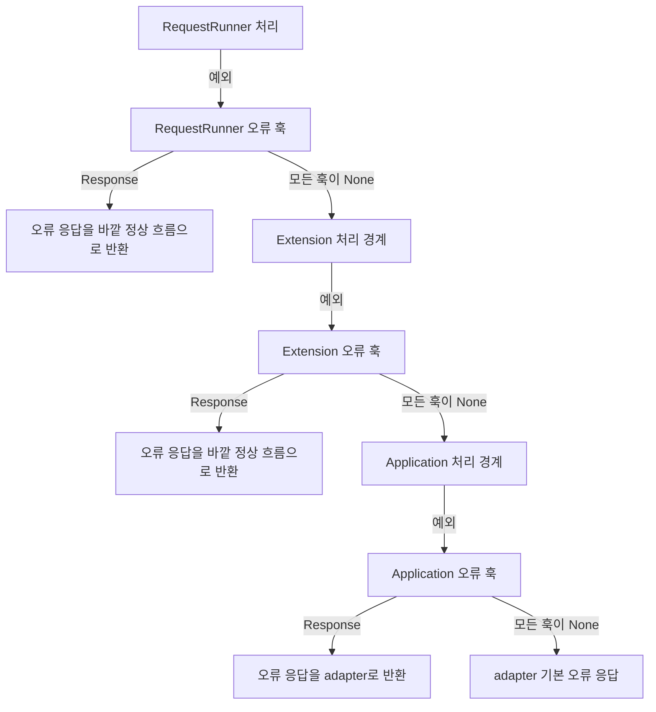

# 요청 오류 처리

[← 매뉴얼 목차](./README.md)

[English](./ErrorHandling.en.md)

이 문서는 HTTP 요청 처리 중 발생한 예외를 관찰하고 사용자 정의 `Response`로 복구하는 방법을 설명합니다. 오류 훅이 `Response`를 반환하면 해당 응답이 오류 결과가 됩니다. `None`을 반환하면 훅은 오류를 처리하지 않은 것이므로 예외가 다음 오류 훅 또는 바깥 처리 계층으로 전파됩니다.

## 오류 처리 경계

요청을 처리하는 동안에는 RequestRunner, Extension, Application이 각각 자신의 처리 범위에 오류 훅을 제공합니다. 가장 안쪽 계층부터 오류를 처리하고, 그 계층이 예외를 처리하지 않은 경우에만 바깥 계층으로 전파합니다.



각 오류 훅은 해당 계층 안에서 발생한 예외만 처리합니다. 예를 들어 route의 응답 훅에서 오류가 났다면 RequestRunner 오류 훅이 먼저 실행됩니다. 그 오류 훅이 `Response`를 반환하면 원래 예외는 처리된 것이므로 같은 예외를 Application 오류 훅에 다시 전달하지 않습니다.

다만 오류 응답을 바깥 계층의 정상 응답 처리로 전달한 뒤 그 계층에서 새 예외가 생기면, 새 예외는 해당 바깥 계층의 오류 훅으로 전달됩니다. 이미 오류 응답을 만든 안쪽 오류 훅은 다시 실행하지 않습니다.

요청 객체가 만들어지기 전에 발생한 실패는 Application 요청 훅에 들어오지 않습니다. Application이 응답을 adapter에 반환한 다음의 직렬화, 네트워크, 본문 전송 실패도 Application 요청 오류 훅으로 되돌아오지 않습니다. 시작·정리 훅의 실패는 HTTP 요청 오류와 별도의 생명주기 오류입니다. 생명주기 실행 순서는 [애플리케이션 생명주기](./Lifecycle.md)를 참고하세요.

## 오류 훅 계약

| 오류 훅 계약 | 등록 위치 | 인자 | 반환값 |
| --- | --- | --- | --- |
| `RequestRunnerRequestError` | `RequestRunner` 클래스 선언의 `on_request_error` | `Request`, `Exception` | `Optional[Response]` |
| `ExtensionRequestError` | `Extension` 생성자의 `on_request_error` | `Request`, `Exception` | `Optional[Response]` |
| `ApplicationRequestError` | `Application` 생성자의 `on_request_error` 또는 extension의 동적 요청 훅 등록 | `Request`, `Exception` | `Optional[Response]` |

오류 훅은 기존 `(request, error)` 인자를 그대로 받습니다. 하나의 훅 또는 순서가 있는 훅 시퀀스를 등록할 수 있습니다.

| 반환값 | 의미 | 다음 동작 |
| --- | --- | --- |
| `None` | 이 훅은 오류를 처리하지 않음 | 같은 계층의 다음 오류 훅을 실행 |
| `Response` | 이 훅이 오류를 응답으로 처리 | 이 응답을 채택하고 같은 계층의 나머지 오류 훅을 중단 |
| 그 밖의 값 | 계약 위반 | `TypeError` 발생, 후속 오류 훅은 실행하지 않음 |

같은 계층에서 모든 훅이 `None`을 반환하면 해당 계층은 원래 예외를 다시 전파합니다. 등록 순서는 오류 훅 시퀀스가 설정된 순서와 같으며, `[None, Response, sentinel]`로 구성했다면 첫 훅 다음에 두 번째 훅이 실행되고 세 번째 훅은 실행되지 않습니다.

오류가 발생한 계층의 정상 응답 훅은 오류 응답에 재실행되지 않습니다. 대신 응답은 바깥 계층으로 정상 반환되어 그 바깥 계층의 응답 처리 흐름을 따릅니다. 따라서 RequestRunner에서 복구한 응답은 Application 응답 훅을 통과할 수 있고, Extension에서 복구한 응답은 바깥 RequestRunner 및 Application의 정상 응답 처리로 이어집니다.

오류 훅 자체에서 예외가 발생하면 그 예외가 호출자에게 전파됩니다. Python 예외 체인에는 처리 중이던 원래 예외가 유지되며, 같은 계층의 후속 오류 훅은 실행하지 않습니다.

## 기본 HTTP 오류 응답

오류 훅이 없거나 해당 계층의 모든 오류 훅이 `None`을 반환하면 기존 HTTP adapter 기본 동작이 사용됩니다.

| 전파된 예외 | 기본 응답 |
| --- | --- |
| DefEssential의 `Error` 하위 타입 | 예외의 HTTP 상태 코드, 헤더 및 reason 본문 |
| 그 밖의 예외 | 일반 `500 Internal Server Error`; 예외 세부 내용은 클라이언트에 노출하지 않음 |

`Error`, `ClientError`, `ServerError`는 HTTP 상태 코드와 오류 reason을 표현합니다. 사용자 오류 훅이 `Response`를 반환하면 해당 상태 코드, 헤더 및 본문은 훅이 결정하며 adapter는 그 응답을 기본 오류 응답으로 교체하지 않습니다.

## Application 오류 응답 예시

다음 예시는 예측하지 못한 서버 예외를 로그로 관찰하고, 내부 오류 정보를 노출하지 않는 응답으로 처리합니다. `ClientError`는 `None`을 반환하여 adapter의 기존 상태 코드·오류 본문 처리를 유지합니다.

```python
from logging import getLogger
from typing import Optional

from DefEssential import (
  Application,
  ApplicationRequestError,
  ClientError,
  Request,
  RequestRunner,
  Response,
)


logger = getLogger('Example')


class HandleRequestError(ApplicationRequestError):
  def __call__(
    self,
    request: Request,
    error: Exception,
  ) -> Optional[Response]:
    if isinstance(error, ClientError):
      return None

    logger.error(
      'request failed: request_id=%s error_type=%s',
      request.id,
      type(error).__name__,
    )
    return Response(
      status=500,
      body=b'The request could not be completed.',
    )


class Readiness(RequestRunner, method='GET', url='/ready'):
  def run(self, request: Request) -> Response:
    raise RuntimeError('internal database detail')


application = Application(on_request_error=HandleRequestError())
application.add(Readiness)
```

`GET /ready`에서 발생한 `RuntimeError`는 Application 오류 훅에서 응답으로 처리됩니다. 해당 훅이 만든 본문에는 예외 메시지가 포함되지 않습니다. 실제 운영 환경에서는 오류를 분류하고 필요한 서버 측 로그·메트릭·추적을 남기되, 클라이언트 응답은 별도로 안전하게 구성하세요.

`RequestRunner` 수준의 오류 훅은 클래스 선언에, Extension 오류 훅은 extension 생성자에 같은 방식으로 지정합니다. route 전용 정책은 `RequestRunner`, 확장 내부 정책은 Extension, 여러 route에 공통인 정책은 Application에 두면 책임 범위가 명확해집니다.

## RequestRunner 오류 응답 예시

특정 route에서만 발생하는 오류 정책은 `RequestRunner` 클래스에 `on_request_error`를 지정할 수 있습니다. 다음 예시는 사용자 조회 중 발생한 404 `ClientError`를 route에 맞는 응답으로 바꾸고, 나머지 오류는 `None`을 반환해 바깥 계층 또는 adapter가 처리하도록 둡니다.

```python
from typing import Optional

from DefEssential import (
  Application,
  ClientError,
  Request,
  RequestRunner,
  RequestRunnerRequestError,
  Response,
)


class HandleUserError(RequestRunnerRequestError):
  def __call__(
    self,
    request: Request,
    error: Exception,
  ) -> Optional[Response]:
    if isinstance(error, ClientError) and error.status == 404:
      return Response(
        status=404,
        body=b'The requested user was not found.',
      )
    return None


class UserDetail(
  RequestRunner,
  method='GET',
  url='/users/:user_id',
  on_request_error=HandleUserError(),
):
  def run(self, request: Request) -> Response:
    raise ClientError(
      'user not found',
      status=404,
    )


application = Application()
application.add(UserDetail)
```

이 오류 응답은 `UserDetail`의 RequestRunner 오류 훅에서 처리되므로 원래 `ClientError`는 Application 오류 훅으로 전파되지 않습니다. 같은 RequestRunner의 응답 훅과 CORS 응답 처리는 복구 응답에 다시 적용되지 않지만, Application의 정상 응답 훅은 실행될 수 있습니다. 공통 오류 정책이 필요하면 Application 오류 훅을 사용하세요.

## 응답 훅과의 순서

해당 계층의 정상 응답 생성, 검증 및 응답 훅은 오류 훅보다 먼저 실행됩니다. 정상 응답 처리 중 예외가 발생하면 해당 계층 오류 훅으로 이동합니다. 오류 응답은 실패했던 같은 계층의 정상 응답 훅에 다시 전달하지 않으며, 바깥 계층에서는 정상 응답으로 이어집니다.

예를 들어 RequestRunner 응답 훅이 실패했을 때 RequestRunner 오류 훅이 복구 응답을 반환하면:

1. 실패한 RequestRunner 응답 훅과 같은 계층의 남은 응답 훅은 다시 실행되지 않습니다.
2. RequestRunner에서 복구 응답을 바깥 Application으로 반환합니다.
3. Application 응답 훅은 정상 응답을 받은 것처럼 실행됩니다.
4. Application 응답 훅이 새 예외를 발생시키면 Application 오류 훅이 새 예외를 처리합니다.

오류 응답을 반환한 오류 훅은 처리한 원래 예외에 대해 다시 호출되지 않습니다. 바깥 정상 응답 처리에서 생긴 새로운 예외만 바깥 오류 훅이 다룹니다.

## 직접 출력과 스트리밍 제약

직접 출력 writer가 응답을 시작하면 상태 코드와 헤더가 이미 전송되었으므로 오류 `Response`로 교체할 수 없습니다. 오류 훅이 이 시점에 `Response`를 반환해도 성공으로 간주하지 않습니다. 해당 응답 본문을 정리하고 전송 실패를 호출자에게 전달하며, 기존 writer 상태와 정리 규칙을 유지합니다.

응답이 Application에서 adapter로 반환된 뒤 발생하는 스트리밍 본문·네트워크 전송 오류도 새 HTTP 응답으로 바꿀 수 없습니다. 이 실패는 adapter와 transport의 연결 오류 경로에서 처리됩니다.

`RequestRunner` 오류 훅이 응답을 반환하면 실패한 `RequestRunner` 응답 훅과 CORS 응답 처리는 다시 실행되지 않습니다. 오류 응답에도 필요한 보안 헤더나 CORS 헤더가 있다면 복구 응답 또는 바깥 계층에서 명시적으로 구성하세요.

## 운영 시 점검 사항

- 요청 ID와 오류 유형 등 필요한 식별 정보는 기록하되, 응답 본문, 인증 정보, 개인정보와 비밀값은 로그에 남기지 마세요.
- 클라이언트 응답은 내부 경로·쿼리·데이터베이스 메시지·stack trace를 노출하지 않도록 별도로 구성하세요.
- 오류 훅에서 반환하지 않고 로깅만 하고 싶다면 명시적으로 `None`을 반환하세요. 예외를 처리하지 않으면 기존 계층과 adapter로 계속 전파됩니다.
- 같은 계층에 여러 오류 훅을 둘 때는 등록 순서와 최초 `Response` 이후 훅이 중단되는 점을 고려하세요.
- 오류 훅 구현이 예외를 발생시키거나 `Response`/`None` 이외 값을 반환하는 경우도 테스트하세요.
- 오류 응답에 적용되어야 하는 보안 헤더, CORS 정책, 콘텐츠 타입을 운영 환경에 맞게 검토하세요.
- 반환 응답의 본문은 정상 `Response`와 같은 소유권·닫기 규칙을 따릅니다. 직접 전달하거나 스트리밍하는 본문의 정리 책임도 확인하세요.

## 검증 권고

오류 처리 변경 후에는 아래 동작을 계층별로 검증하세요.

1. 오류 훅이 `Response`를 반환하면 해당 응답이 adapter까지 전달되고 같은 계층의 후속 오류 훅은 실행되지 않습니다.
2. 오류 훅이 모두 `None`을 반환하면 예외가 상위 계층으로 전파되어 기본 adapter 오류 응답을 유지합니다.
3. 오류 응답이 바깥 정상 응답 훅을 통과하고, 그 처리에서 발생한 새 예외가 바깥 오류 훅으로 전달됩니다.
4. 오류 훅 예외와 잘못된 반환값이 무시되지 않고, 후속 오류 훅도 실행되지 않습니다.
5. writer 시작 이후에는 오류 응답이 기존 직접 출력이나 스트림을 교체하지 않습니다.
6. 기존 오류 없는 요청과 `None` 반환 관찰 훅이 같은 순서·결과를 유지합니다.
