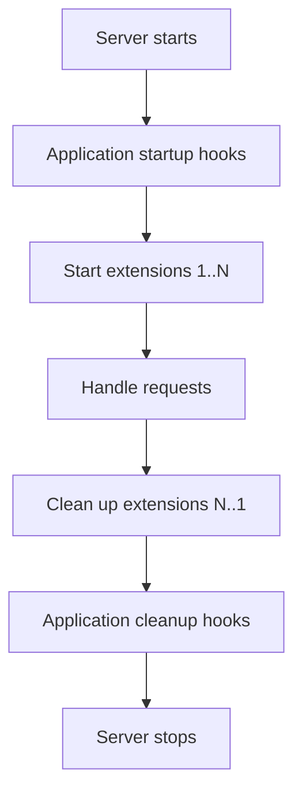

# Extensions and server adapters

[← Guide index](./README.en.md)

[한국어](./ExtensionsAndServers.md)

An extension is a reusable component that can register routes or prepare resources when an application starts and clean them up when it stops. A server adapter is the transport layer that runs the same `Application` on a selected HTTP server.

## Built-in extensions

Pass an ordered sequence of extension instances through `Application(exts=(...))`. Extensions start when the application starts and clean up in reverse startup order when it stops.

| Extension | Purpose |
| --- | --- |
| `Ping` | Simple health-check response |
| `Status` | Browser-readable status page |
| `Metrics` | Collect request counts, durations, and related metrics |
| `Specifications` | Serve OpenAPI from route declarations |
| `Swagger` | Provide a UI for browsing a `Specifications` document |
| `File` | Respond with a configured file or resource |
| `FileSystem` | Provide file-serving routes backed by a filesystem |

Register only the extensions the application needs:

```python
from DefEssential import Application
from DefEssential.Extensions import (
  Metrics,
  Ping,
  Specifications,
  Swagger,
)


application = Application(exts=(
  Metrics('/metrics'),
  Ping('/ping'),
  Specifications('/api/doc', title='Example API'),
  Swagger('/swagger', spec_uri='/api/doc'),
))
```

`Swagger` fetches the OpenAPI document from `spec_uri`, so `Specifications` must serve that path. The accuracy of the specification depends on handler `summary`, `description`, `tags`, input content, and response definitions. Consider whether access to status, metrics, and documentation endpoints should be restricted in production.

An extension instance can belong to only one `Application`. Do not share an instance across applications; create a fresh instance for each one. A custom extension can implement the `Extension` contract and provide request, response, error, startup, and cleanup hooks.

## Register handlers from modules

`Application.load(mod=...)` or `Application.load(path=...)` finds and registers concrete `RequestRunner` subclasses in loaded modules. This separates handler definitions from application setup.

```python
from DefEssential import Application


application = Application()
application.load(mod='myapp.handlers')
```

The module must be importable at runtime, and each discovered handler must have a valid `method` and `url`. Missing handlers and duplicate routes are not silently ignored; registration raises an error.

## Choose a server

The built-in Python adapter works without an external server package:

```python
from DefEssential.Adapter.Implements.Python import Server

server = Server('127.0.0.1', 8000, application)
server.run()
```

| Adapter | Install | Behavior and considerations |
| --- | --- | --- |
| Python | Default install | Uses the standard library threaded HTTP server; suitable for development and basic use |
| Gunicorn | `DefEssential[Gunicorn]` | POSIX only. Cannot run on Windows; use Linux or WSL |
| Uvicorn | `DefEssential[Uvicorn]` | Runs the synchronous app through the `a2wsgi` boundary. Application instances require `workers=1`, `reload=False` |

The Gunicorn adapter accepts `host`, `port`, `workers`, `worker_class`, and additional Gunicorn options. It raises an error when run on Windows, so do not try to run it in native Windows.

The Uvicorn adapter provides `wsgi_workers` and `send_queue_size`; both must be positive. It does not allow `workers` greater than one or `reload=True`. The adapter manages WebSocket framing; configure WebSocket limits and behavior in the handler rather than passing Uvicorn `ws` options.

`wsgi_workers` is the number of adapter-side workers that execute the synchronous application, not the number of Uvicorn process workers. If you need more processes, review application state sharing, how often startup/cleanup runs, and whether extension instances are created per process. This adapter does not allow one `Application` instance to be shared across multiple Uvicorn workers.

## Server startup and shutdown

Server adapters call application startup and stop methods. On startup, application startup hooks run before extensions start in order. On shutdown, extensions clean up in reverse order, followed by application cleanup hooks.



See [Application lifecycle](./LifecycleAndErrors.en.md) for hook arguments, request/response/error ordering, and exception behavior.
