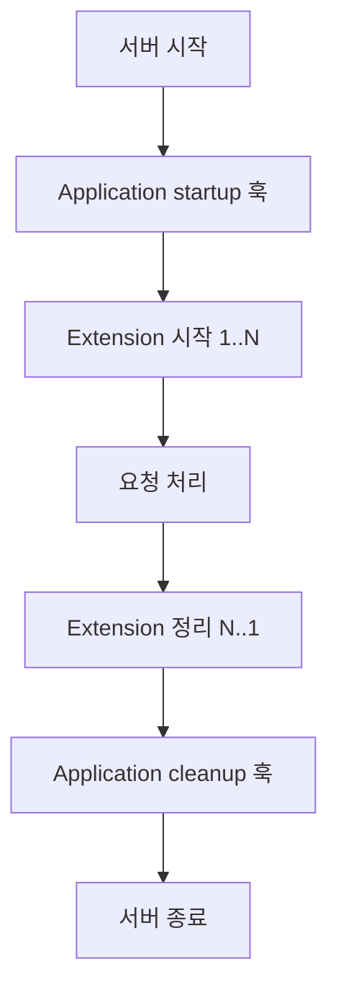

# 확장과 서버 어댑터

[← 매뉴얼 목차](./README.md)

[English](./ExtensionsAndServers.en.md)

확장은 애플리케이션 시작 때 라우트를 등록하거나 외부 자원을 준비하고, 종료 때 정리할 수 있는 재사용 가능한 구성 요소입니다. 서버 adapter는 같은 `Application`을 서로 다른 HTTP 서버에서 실행하는 연결 계층입니다.

## 기본 제공 확장

확장은 `Application(exts=(...))`에 순서가 있는 인스턴스 시퀀스로 전달합니다. 앱이 시작될 때 확장이 시작되고, 종료될 때 시작 순서의 역순으로 정리됩니다.

| 확장 | 용도 |
| --- | --- |
| `Ping` | 간단한 health check 응답 |
| `Status` | 브라우저에서 볼 수 있는 상태 페이지 |
| `Metrics` | 요청 처리 횟수·시간 등 지표 수집 |
| `Specifications` | 라우트 선언에서 OpenAPI 문서 제공 |
| `Swagger` | `Specifications` 문서를 탐색할 UI 제공 |
| `File` | 정해진 파일 또는 리소스 응답 |
| `FileSystem` | 파일 시스템을 통한 파일 응답 라우트 제공 |

필요한 확장만 선택해 등록합니다.

```python
from DefChord import Application
from DefChord.Extensions import (
  Metrics,
  Ping,
  Specifications,
  Swagger,
)


application = Application(exts=(
  Metrics('/metrics'),
  Ping('/ping'),
  Specifications('/api/doc', title='Example API'),
  Swagger('/swagger', spec_uri='/api/doc'),
))
```

`Swagger`는 지정한 `spec_uri`에서 OpenAPI 문서를 가져오므로, 그 경로에 `Specifications`가 등록되어 있어야 합니다. 명세의 정확도는 handler의 `summary`, `description`, `tags`, 입력 콘텐츠와 응답 정의에 달려 있습니다. 운영에서 상태·지표·문서 endpoint에 대한 접근을 제한해야 하는지 검토하세요.

### `Specifications` 문서 형식 선택

`Specifications`는 기본값으로 JSON 문서를 반환합니다.

```python
from DefChord.Extensions import Specifications

spec_json = Specifications('/api/doc')
```

YAML 문서가 필요하면 `document_format='yaml'`을 사용합니다. 이때 응답은 UTF-8 인코딩과 YAML 미디어 타입(`application/yaml`)을 사용합니다.

```python
from DefChord.Extensions import Specifications

spec_yaml = Specifications('/api/doc.yaml', document_format='yaml')
```

YAML 미디어 타입을 바꿔야 한다면 `yaml_media_type`으로 지정할 수 있습니다.

```python
from DefChord.Extensions import Specifications

spec_yaml = Specifications(
  '/api/doc.yaml',
  document_format='yaml',
  yaml_media_type='text/yaml',
)
```

YAML 직렬화는 선택 의존성 `PyYAML`이 필요합니다. 설치되지 않은 상태에서 YAML 형식을 사용하면 `ModuleNotFoundError`가 발생합니다.

```shell
pip install PyYAML
```

`Specifications`가 생성하는 OpenAPI 버전 문자열은 현재 `3.1.0`입니다.

확장 인스턴스는 하나의 `Application`에만 등록할 수 있습니다. 여러 애플리케이션에서 같은 인스턴스를 공유하지 말고 각 앱마다 새 인스턴스를 만드세요. 사용자 정의 확장은 `Extension` 계약을 구현하고 요청, 응답, 오류 및 시작·정리 훅을 제공할 수 있습니다.

## 모듈에서 handler 등록

`Application.load(mod=...)` 또는 `Application.load(path=...)`는 로드한 모듈의 구체 `RequestRunner` 하위 클래스를 찾아 등록합니다. 애플리케이션 코드와 handler 모듈을 분리하면 등록 목록이 한 파일에 집중되지 않습니다.

```python
from DefChord import Application


application = Application()
application.load(mod='myapp.handlers')
```

실행 시 해당 모듈을 import할 수 있어야 하며, 모듈에서 정의한 handler는 유효한 `method`와 `url`을 가져야 합니다. 발견되지 않은 handler나 중복 route는 자동으로 무시되지 않고 등록 과정에서 오류가 발생합니다.

## 서버 선택

기본 Python adapter는 외부 서버 패키지 없이 사용할 수 있습니다.

```python
from DefChord.Adapter.Implements.Python import Server

server = Server('127.0.0.1', 8000, application)
server.run()
```

| Adapter | 설치 | 동작과 주의사항 |
| --- | --- | --- |
| Python | 기본 설치 | 표준 라이브러리의 threaded HTTP 서버 사용. 개발·기본 실행에 적합 |
| Gunicorn | `DefChord[Gunicorn]` | POSIX 플랫폼용. Windows에서는 실행 불가하며 Linux 또는 WSL 필요 |
| Uvicorn | `DefChord[Uvicorn]` | `a2wsgi` 경계를 통해 동기 앱 실행. 앱 인스턴스 설정은 `workers=1`, `reload=False`로 제한 |

Gunicorn adapter는 `host`, `port`, `workers`, `worker_class`와 추가 Gunicorn 옵션을 받습니다. Windows에서는 실행 시 오류를 내므로 native Windows 환경에서 Gunicorn 실행을 시도하지 마세요.

Uvicorn adapter는 `wsgi_workers`와 `send_queue_size`를 제공하며 두 값은 양수여야 합니다. `workers`를 1보다 크게 설정하거나 `reload=True`를 사용할 수 없습니다. adapter가 WebSocket framing을 관리하므로 Uvicorn의 `ws` 관련 옵션을 직접 넘기지 말고 handler의 `WebSocket` 설정을 사용하세요.

`wsgi_workers`는 동기 애플리케이션을 수행하는 adapter 내부 작업자 수이며, Uvicorn 프로세스 worker 수와 다릅니다. 프로세스 수를 늘리고 싶다면 애플리케이션 상태 공유, startup/cleanup 실행 횟수, extension 인스턴스의 프로세스별 생성 여부를 포함해 배포 구성을 검토하세요. 이 adapter는 한 `Application` 인스턴스를 여러 Uvicorn worker에서 공유하는 설정을 허용하지 않습니다.

## 서버 시작·종료

서버 adapter는 애플리케이션 시작과 정지를 호출합니다. 애플리케이션 시작 시 사용자 startup 훅 다음 확장이 순서대로 시작되며, 종료 시 확장은 역순으로 정리된 뒤 애플리케이션 cleanup 훅이 실행됩니다.



자세한 생명주기와 정상 요청·응답 훅 순서는 [애플리케이션 생명주기](./Lifecycle.md)를, 오류 훅과 예외 처리는 [오류 처리](./ErrorHandling.md)를 참고하세요.
