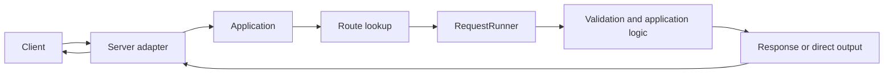

# Installation and your first application

[← Guide index](./README.en.md)

[한국어](./GettingStarted.md)

DefEssential is a synchronous Python web framework. An HTTP server passes each request to an `Application`, where a registered `RequestRunner` validates input, runs application logic, and returns a `Response`.

## Install

Requires Python 3.9 or later. The default installation includes a server based on the Python standard library. Gunicorn and Uvicorn adapters are optional.

```shell
python -m pip install DefEssential
```

Install an extra only when selecting its server adapter:

```shell
python -m pip install "DefEssential[Gunicorn]"
python -m pip install "DefEssential[Uvicorn]"
```

Unselected adapter code is not installed. To modify the source code, see [installation isolation, development and distribution](./Packaging.en.md).

## The smallest application

Save this as `app.py`:

```python
from DefEssential import Application, Request, RequestRunner
from DefEssential.Adapter.Implements.Python import Server
from DefEssential.Responses import ResponseText


class Hello(RequestRunner, method='GET', url='/hello'):
  def run(self, request: Request):
    return ResponseText('Hello, world!')


application = Application()
application.add(Hello)

Server('127.0.0.1', 8000, application).run()
```

Start the server from the project environment:

```shell
python app.py
```

In another terminal, send a request to verify the result:

```shell
curl http://127.0.0.1:8000/hello
```

The response body is `Hello, world!`. Stopping the server ends request handling.

## Four core components

| Component | Responsibility |
| --- | --- |
| `Server` | Accepts connections and handles HTTP requests/responses for its adapter |
| `Application` | Registers routes and dispatches requests to a matching handler |
| `RequestRunner` | Declares a route and validation rules, then handles one request |
| `Request` / `Response` | Represent request and response data independently of the server |



Continue with [Routes, Requests, and Responses](./RoutingAndRequests.en.md) for dispatch, validation, and ordinary responses. See [Streaming and WebSockets](./StreamingAndWebSockets.en.md) for streaming input/output, SSE, and WebSocket.

## Add a route to an application

A handler class declares one HTTP method and path combination. A new handler instance is created for each request, so do not retain request-specific state in handler instance fields.

```python
from DefEssential import Application, Request, RequestRunner
from DefEssential.Responses import ResponseJSON


class Health(RequestRunner, method='GET', url='/health'):
  def run(self, request: Request):
    return ResponseJSON({'status': 'ok'})


application = Application()
application.add(Health)
```

`Application.add()` accepts a concrete `RequestRunner` class. Handler registration cannot be changed while the application is running. For module loading and extensions, see [Extensions and servers](./ExtensionsAndServers.en.md).

## Where to go next

1. Learn path parameters and method routing in [Routes, Requests, and Responses](./RoutingAndRequests.en.md).
2. See query, header, and body validation and content readers in the same guide.
3. See [Routes, Requests, and Responses](./RoutingAndRequests.en.md) for ordinary JSON and file responses, and [Streaming and WebSockets](./StreamingAndWebSockets.en.md) for streaming, SSE, and WebSocket.
4. See [Extensions and servers](./ExtensionsAndServers.en.md) for the built-in server, adapters, and extensions.

## Repository sample and tests

If you have a checkout of the repository, run the combined sample from its root:

```shell
python samples/Sample.py
```

The sample combines routes, request validators, responses, extensions, streaming, and WebSocket behavior. Check the sample code and output for the built-in Python server address and required sample resources.

To see an error hook return a custom response, start the server and request `GET http://127.0.0.1:8000/api/run/error`. This route deliberately raises a `418` error and handles it in a `RequestRunner` error hook with the response body `Handled by RequestRunner error hook.`.

Run the repository tests after installing the checkout in editable mode:

```shell
python -m pip install -e . --config-settings EXTRAS=Gunicorn,Uvicorn
python -m unittest discover -s tests
```

The full test suite imports optional adapters, so install both implementations with the command above. Plain `python -m pip install -e .` connects only the common code and built-in Python server. After editing code, run the tests again to check the result. Repeat the installation command with the desired selection after adding files or changing the installation configuration. See [installation isolation, development and distribution](./Packaging.en.md) for development instructions. Gunicorn/Uvicorn-specific execution and tests remain subject to server platform requirements.
