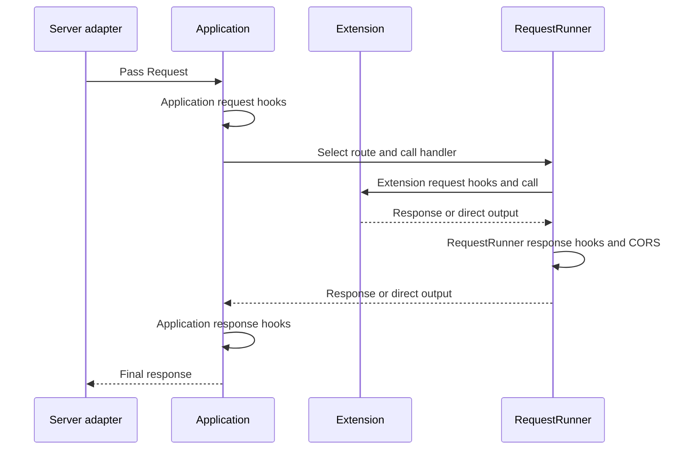

# Application Lifecycle

[← Guide index](./README.en.md)

[한국어](./Lifecycle.md)

DefChord provides hooks for application and extension startup/cleanup, request preprocessing, and response postprocessing. Hooks are explicit contracts that run user code at defined points. Register one hook or an ordered sequence of hooks.

## Application and extension lifecycle

`Application` runs application startup hooks before starting extensions in registration order. On shutdown, it cleans up extensions in reverse order and then runs application cleanup hooks.

| Hook contract | Arguments | Return |
| --- | --- | --- |
| `ApplicationStartup` | None | `None` |
| `ApplicationCleanup` | None | `None` |
| `ExtensionStartup` | None | `None` |
| `ExtensionCleanup` | None | `None` |

```python
from logging import getLogger

from DefChord import (
  Application,
  ApplicationCleanup,
  ApplicationStartup,
)


logger = getLogger('Example')


class PrepareApplication(ApplicationStartup):
  def __call__(self) -> None:
    logger.info('application starting')


class ReleaseApplication(ApplicationCleanup):
  def __call__(self) -> None:
    logger.info('application stopping')


application = Application(
  on_startup=PrepareApplication(),
  on_cleanup=ReleaseApplication(),
)
```

Each option accepts one hook object or an ordered sequence of hook objects. Lifecycle hooks must return `None`; any other value violates the contract.

If startup fails, the application attempts to clean up already-started extensions in reverse order and then re-raises the startup exception. During normal shutdown, a cleanup failure does not prevent cleanup attempts for remaining extensions. After all attempts, the first error is raised to the caller. Cleanup is not guaranteed if the process is forcibly terminated without `Application.stop()`.

## Request and response hook scopes

Request and response hooks can be registered at three scopes: the whole application, an extension, or an individual route.

| Scope | Registration | Purpose |
| --- | --- | --- |
| Application | `Application(on_request=..., on_request_response=...)` | Common request preprocessing and response postprocessing |
| Extension | Same options on the `Extension` constructor | Request preprocessing and response postprocessing for the extension |
| RequestRunner | Same options in the handler class declaration | Request and response processing for a specific route |

A request hook receives a `Request` and returns the `Request` to pass to the next step. A response hook receives a `Request` and response and returns the `Response` to pass onward. In direct-output mode, the response value is `None`, so a response hook cannot create a new ordinary response. If a hook replaces a response, the returned object is passed to the next step.

Error-hook return contracts and exception handling are covered in the separate [Error Handling guide](./ErrorHandling.en.md).

## Normal request order



The normal response path has these main steps:

1. Application request hooks receive and may transform the request. Hooks registered by extensions run before hooks passed to the `Application` constructor.
2. The application selects a route and HTTP method, then the route handler validates Origin, authentication, path parameters, query values, headers, and the request body.
3. The handler instance is created, its `RequestRunner` request hooks run, and `run(request)` is called.
4. For an extension route, extension request hooks, the extension call, and extension response hooks run.
5. Returned responses pass through `RequestRunner` response hooks and CORS processing. Direct output uses the writer.
6. Application response hooks run, then the final response is passed to the server adapter.

## Route request and response hook example

```python
from logging import getLogger

from DefChord import (
  Request,
  RequestRunner,
  RequestRunnerRequest,
  RequestRunnerRequestResponse,
)
from DefChord.Responses import ResponseText


class RequestLog(RequestRunnerRequest):
  def __call__(self, request: Request) -> Request:
    getLogger('Example').info(
      'request_id=%s method=%s path=%s',
      request.id,
      request.method,
      request.path,
    )
    return request


class AddResponseHeader(RequestRunnerRequestResponse):
  def __call__(self, request: Request, response):
    response.header('X-Request-ID', request.id)
    return response


class Hello(
  RequestRunner,
  method='GET',
  url='/hello',
  on_request=RequestLog(),
  on_request_response=AddResponseHeader(),
):
  def run(self, request: Request):
    return ResponseText('Hello')
```

`RequestRunner` request hooks run after the handler is created and route-specific validation is complete. Response hooks run after `run()` returns a `Response` and before CORS processing and transmission. This example adds the request ID to the route response. Multiple hooks run in registration order, so each hook should accept the request or response shape passed by the previous hook.

## Hook implementation considerations

- A hook that replaces a request or response should return the object that downstream processing must use.
- Preserve hook argument and return contracts; do not hide unexpected exceptions behind successful results.
- Do not log sensitive data such as response bodies, credentials, or session contents. Select only the minimum request identifiers needed for operations.
- Direct output and streaming responses cannot change their status or body after transmission begins.
- See the [Error Handling guide](./ErrorHandling.en.md) for error hooks and custom error responses.
