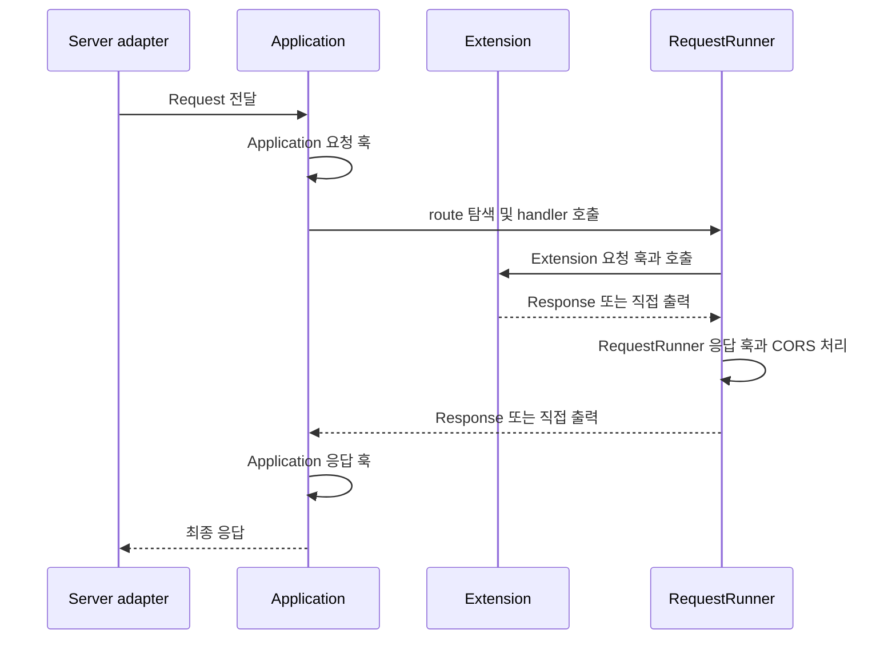

# 애플리케이션 생명주기

[← 매뉴얼 목차](./README.md)

[English](./Lifecycle.en.md)

DefEssential은 애플리케이션과 확장의 시작·정리, 요청 전처리, 응답 후처리를 위한 훅을 제공합니다. 훅은 지정된 시점에 사용자 코드를 실행하는 명시적 계약이며, 하나의 훅 또는 순서가 있는 훅 시퀀스를 등록할 수 있습니다.

## 애플리케이션과 확장 생명주기

`Application`은 애플리케이션 시작 훅을 실행한 뒤 extensions를 등록 순서대로 시작합니다. 종료할 때는 extensions를 역순으로 정리한 다음 애플리케이션 종료 훅을 실행합니다.

| 훅 계약 | 전달 인자 | 반환 |
| --- | --- | --- |
| `ApplicationStartup` | 없음 | `None` |
| `ApplicationCleanup` | 없음 | `None` |
| `ExtensionStartup` | 없음 | `None` |
| `ExtensionCleanup` | 없음 | `None` |

```python
from logging import getLogger

from DefEssential import (
  Application,
  ApplicationCleanup,
  ApplicationStartup,
)


logger = getLogger('Example')


class PrepareApplication(ApplicationStartup):
  def __call__(self) -> None:
    logger.info('application starting')


class ReleaseApplication(ApplicationCleanup):
  def __call__(self) -> None:
    logger.info('application stopping')


application = Application(
  on_startup=PrepareApplication(),
  on_cleanup=ReleaseApplication(),
)
```

각 옵션에는 훅 객체 하나 또는 순서 있는 훅 객체 시퀀스를 지정할 수 있습니다. 생명주기 훅은 `None`을 반환해야 합니다. 다른 값을 반환하면 계약 위반입니다.

시작 중 실패하면 이미 시작된 extensions를 역순으로 정리하려 시도한 뒤 시작 예외를 다시 전달합니다. 정상 정지 중 하나의 extension 정리가 실패해도 나머지 정리를 계속 시도하며, 모든 시도 후 첫 오류를 호출자에게 전달합니다. `Application.stop()`을 실행하지 않고 프로세스를 강제 종료하면 정리는 보장되지 않습니다.

## 요청과 응답 훅의 범위

요청과 응답 훅은 애플리케이션 전체, extension, 개별 route의 세 범위에서 등록할 수 있습니다.

| 범위 | 등록 위치 | 역할 |
| --- | --- | --- |
| Application | `Application(on_request=..., on_request_response=...)` | 애플리케이션 공통 요청 전처리와 응답 후처리 |
| Extension | `Extension` 생성자의 동일한 옵션 | 확장 기능에 필요한 요청 전처리와 응답 후처리 |
| RequestRunner | handler 클래스 선언의 동일한 옵션 | 특정 route의 요청 처리와 응답 후처리 |

요청 훅은 `Request`를 받아 후속 단계에 전달할 `Request`를 반환합니다. 응답 훅은 `Request`와 응답을 받아 다음 단계에 전달할 `Response`를 반환합니다. 직접 출력 모드에서는 응답 객체 대신 `None`이 전달되므로 응답 훅에서 일반 응답을 새로 만들 수 없습니다. 훅이 응답 객체를 교체하면 반환한 객체가 다음 단계로 전달됩니다.

오류 훅의 반환 계약과 예외 처리 흐름은 별도 [오류 처리 매뉴얼](./ErrorHandling.md)에서 다룹니다.

## 정상 요청의 실행 순서



정상 응답 경로의 주요 단계는 다음과 같습니다.

1. Application 요청 훅이 요청을 받아 변환하거나 다음 단계로 전달합니다. extension이 등록한 Application 요청 훅은 Application 생성자에 전달한 훅보다 먼저 실행됩니다.
2. Application이 route와 HTTP 메서드를 선택하고, route handler의 Origin·인증·경로 매개변수·쿼리·헤더·본문 검증을 진행합니다.
3. handler 인스턴스를 생성하고 `RequestRunner` 요청 훅을 실행한 뒤 `run(request)`를 호출합니다.
4. Extension route라면 Extension 요청 훅과 extension 호출, extension 응답 훅이 실행됩니다.
5. 반환된 응답에는 `RequestRunner` 응답 훅과 CORS 응답 처리가 적용됩니다. 직접 출력은 writer를 통해 처리됩니다.
6. Application 응답 훅을 적용하고, 최종 응답을 server adapter에 전달합니다.

## Route 요청·응답 훅 예시

```python
from logging import getLogger

from DefEssential import (
  Request,
  RequestRunner,
  RequestRunnerRequest,
  RequestRunnerRequestResponse,
)
from DefEssential.Responses import ResponseText


class RequestLog(RequestRunnerRequest):
  def __call__(self, request: Request) -> Request:
    getLogger('Example').info(
      'request_id=%s method=%s path=%s',
      request.id,
      request.method,
      request.path,
    )
    return request


class AddResponseHeader(RequestRunnerRequestResponse):
  def __call__(self, request: Request, response):
    response.header('X-Request-ID', request.id)
    return response


class Hello(
  RequestRunner,
  method='GET',
  url='/hello',
  on_request=RequestLog(),
  on_request_response=AddResponseHeader(),
):
  def run(self, request: Request):
    return ResponseText('Hello')
```

`RequestRunner` 요청 훅은 handler가 생성되고 route별 검증이 끝난 뒤 실행됩니다. 응답 훅은 `run()`이 `Response`를 반환한 뒤 CORS 처리와 전송 전에 실행됩니다. 이 예시는 route 응답에 요청 ID를 추가합니다. 여러 훅을 등록하면 설정 순서대로 실행되므로 각 훅은 앞선 훅이 전달하는 요청·응답 형식을 따라야 합니다.

## 훅 사용 시 주의점

- 요청 또는 응답을 교체하는 훅은 후속 단계가 사용할 객체를 반환해야 합니다.
- 훅의 인자와 반환 계약을 유지하고, 예상하지 못한 예외를 성공 결과로 숨기지 마세요.
- 응답 본문, 인증 정보, 세션 등 민감한 데이터는 로그에 남기지 마세요. 운영에 필요한 최소한의 요청 식별 정보만 선택하세요.
- 직접 출력과 스트리밍은 응답 전송이 시작된 뒤 상태 코드와 본문을 바꿀 수 없습니다.
- 오류 훅과 오류 응답을 구성하는 방법은 [오류 처리 매뉴얼](./ErrorHandling.md)을 참고하세요.
