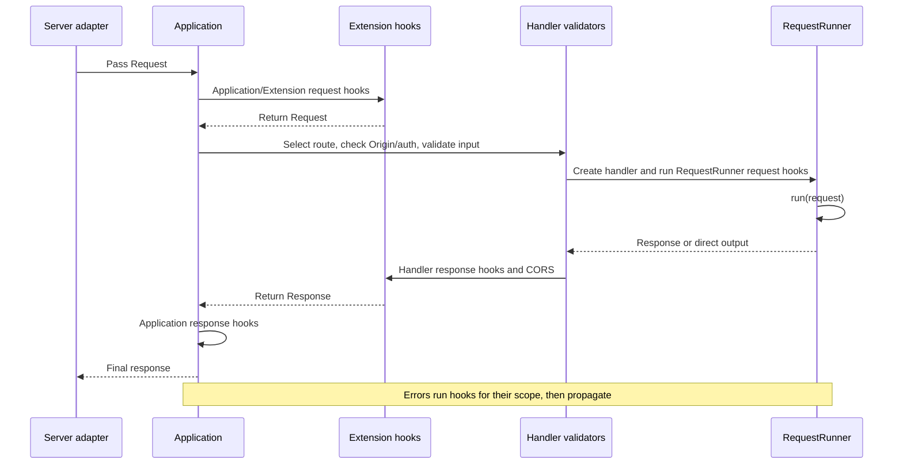

# Application lifecycle and error handling

[← Guide index](./README.en.md)

[한국어](./LifecycleAndErrors.md)

DefEssential provides hooks for application startup/shutdown, request entry, response transformation, and error observation. Hooks are explicit contracts that run user code at defined points. Each hook must follow its argument and return-value contract, and hook sequences run in registration order.

## Application and extension lifecycle

`Application` runs startup hooks before starting extensions in registration order. On shutdown it cleans up extensions in reverse order, then runs application cleanup hooks.

| Hook contract | Arguments | Return |
| --- | --- | --- |
| `ApplicationStartup` | None | `None` |
| `ApplicationCleanup` | None | `None` |
| `ExtensionStartup` | None | `None` |
| `ExtensionCleanup` | None | `None` |

```python
from logging import getLogger

from DefEssential import (
  Application,
  ApplicationCleanup,
  ApplicationStartup,
)


logger = getLogger('Example')


class PrepareApplication(ApplicationStartup):
  def __call__(self) -> None:
    logger.info('application starting')


class ReleaseApplication(ApplicationCleanup):
  def __call__(self) -> None:
    logger.info('application stopping')


application = Application(
  on_startup=PrepareApplication(),
  on_cleanup=ReleaseApplication(),
)
```

Each option accepts one hook object or an ordered sequence of hook objects. Returning a value other than `None` violates the contract.

If startup fails, the application attempts to clean up already-started extensions in reverse order and re-raises the startup exception. During normal shutdown, a cleanup failure does not prevent cleanup of remaining extensions. After all cleanup attempts, the first error is raised to the caller. Cleanup is not guaranteed if the process is forcibly terminated without `Application.stop()`.

## Three scopes of request hooks

Request hooks differ by registration scope and execution point:

| Scope | Registration | Purpose |
| --- | --- | --- |
| Application | `Application(on_request=..., on_request_response=..., on_request_error=...)` | Preprocess, postprocess, and observe errors across application requests |
| Extension | Same options on the `Extension` constructor | Request handling and observation required by an extension |
| RequestRunner | Same options in the handler class declaration | Handle and observe requests for a specific route |

A request hook receives a `Request` and returns the request to continue processing. If it replaces the request, it must return the correct object for downstream handlers. A response hook receives a `Request` and response and returns a `Response`. In direct-output mode the response is `None`; a response hook cannot create a new ordinary response in that case. An error hook receives a `Request` and `Exception`, observes the failure, and returns `None`.

## One request, end to end



The detailed order is:

1. Application request hooks receive and may transform the request. Hooks registered by extensions run before the application's own request hooks.
2. The application selects a route and HTTP method.
3. The handler validates Origin, authentication, path parameters, query values, headers, and body.
4. A handler instance is created and its `RequestRunner` request hooks run.
5. `run()` is called. For an ordinary response, handler response hooks and CORS response headers are applied.
6. Application response hooks run, then the response is returned to the server adapter.

Depending on where an error occurs, `RequestRunnerRequestError`, `ExtensionRequestError`, and `ApplicationRequestError` can observe it. Error hooks observe errors; they do not convert them into responses, and the exception continues to propagate. Configure custom HTTP error responses with `Error`, `ClientError`, `ServerError`, or the relevant validator's error option.

## Write route request and response hooks

```python
from logging import getLogger

from DefEssential import (
  Request,
  RequestRunner,
  RequestRunnerRequest,
  RequestRunnerRequestResponse,
)
from DefEssential.Responses import ResponseText


class RequestLog(RequestRunnerRequest):
  def __call__(self, request: Request) -> Request:
    getLogger('Example').info(
      'request_id=%s method=%s path=%s',
      request.id,
      request.method,
      request.path,
    )
    return request


class AddResponseHeader(RequestRunnerRequestResponse):
  def __call__(self, request: Request, response):
    response.header('X-Request-ID', request.id)
    return response


class Hello(
  RequestRunner,
  method='GET',
  url='/hello',
  on_request=RequestLog(),
  on_request_response=AddResponseHeader(),
):
  def run(self, request: Request):
    return ResponseText('Hello')
```

`RequestRunner` request hooks run after the handler is created. Authentication and path/query/header/body validation are complete before these hooks. Response hooks run after `run()` returns a `Response` and before CORS headers are applied and the response is sent. This example adds the request ID to a response header. A response hook must return the response it produces. For direct output, the hook runs when the response starts, but it cannot replace a body as it could for an ordinary response. Use Application hooks for cross-request correlation and common observation, and handler hooks for route-specific behavior.

## Hook implementation considerations

- Hook sequences run in the configured order. A transforming hook should provide the input shape expected by the next hook.
- Do not change the argument count or return value arbitrarily; hook contracts are typed.
- Avoid logging response bodies, credentials, or session data. Select only the minimum operational information, such as request ID, method, and path.
- Hook exceptions are not hidden behind successful responses. Cleanup errors propagate after all possible cleanup is attempted.
- Streaming responses can fail after headers have been sent, so status and body cannot be replaced as they can for an ordinary response.
