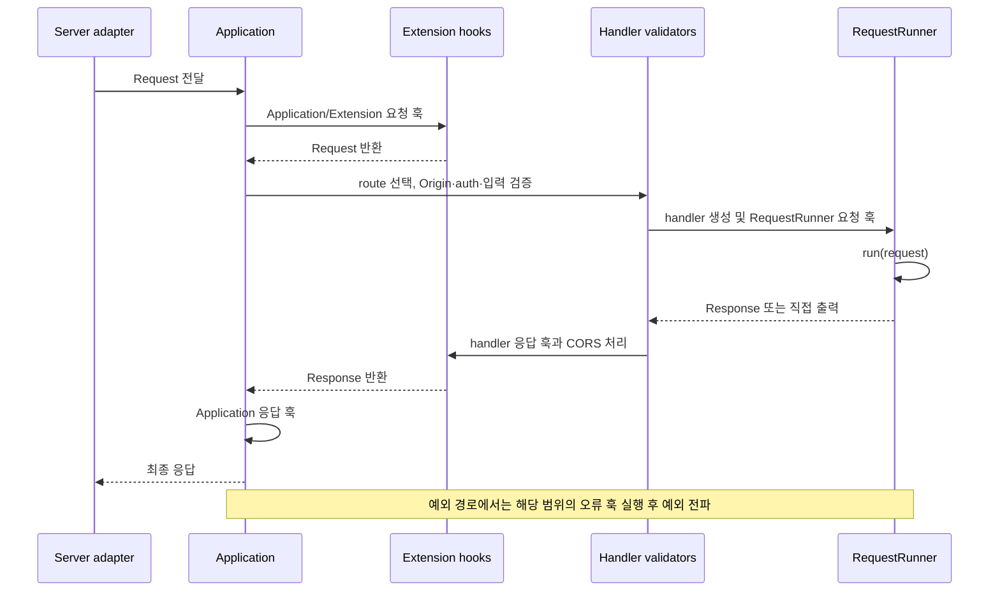

# 애플리케이션 생명주기와 오류 처리

[← 매뉴얼 목차](./README.md)

[English](./LifecycleAndErrors.en.md)

DefEssential은 애플리케이션 시작·종료, 요청 진입, 응답 변환, 오류 관찰을 위한 훅을 제공합니다. 훅은 사용자 코드가 특정 시점에 실행되도록 연결하는 명시적 계약입니다. 각 훅은 정해진 인자와 반환형을 따라야 하며, 등록한 순서대로 실행됩니다.

## 애플리케이션과 확장 생명주기

`Application`은 시작 훅 다음에 extensions를 등록 순서대로 시작합니다. 종료할 때는 extensions를 역순으로 정리한 다음 앱 cleanup 훅을 실행합니다.

| 훅 계약 | 전달 인자 | 반환 |
| --- | --- | --- |
| `ApplicationStartup` | 없음 | `None` |
| `ApplicationCleanup` | 없음 | `None` |
| `ExtensionStartup` | 없음 | `None` |
| `ExtensionCleanup` | 없음 | `None` |

```python
from logging import getLogger

from DefEssential import (
  Application,
  ApplicationCleanup,
  ApplicationStartup,
)


logger = getLogger('Example')


class PrepareApplication(ApplicationStartup):
  def __call__(self) -> None:
    logger.info('application starting')


class ReleaseApplication(ApplicationCleanup):
  def __call__(self) -> None:
    logger.info('application stopping')


application = Application(
  on_startup=PrepareApplication(),
  on_cleanup=ReleaseApplication(),
)
```

각 옵션에는 하나의 훅 객체 또는 순서 있는 훅 객체 시퀀스를 지정할 수 있습니다. 훅이 `None` 이외의 값을 반환하면 계약 위반으로 처리됩니다.

애플리케이션 시작 도중 실패하면 이미 시작된 extensions를 역순으로 정리하려 시도하고 시작 예외를 다시 전달합니다. 정상 정지 때는 하나의 extension 정리 실패가 나머지 extensions 정리를 막지 않습니다. 모든 정리 시도 후 첫 오류를 호출자에게 전달합니다. `Application.stop()`을 실행하지 않고 프로세스를 강제 종료하면 cleanup 실행은 보장되지 않습니다.

## 요청 훅의 세 범위

요청 관련 훅은 등록 위치와 실행 시점이 다릅니다.

| 범위 | 등록 방법 | 역할 |
| --- | --- | --- |
| Application | `Application(on_request=..., on_request_response=..., on_request_error=...)` | 전체 애플리케이션 요청 전처리·후처리·오류 관찰 |
| Extension | `Extension` 생성자의 동일한 옵션 | 확장 기능에 필요한 요청 처리와 관찰 |
| RequestRunner | handler 클래스 선언의 동일한 옵션 | 특정 route의 요청 처리와 관찰 |

요청 훅은 `Request`를 받아 처리할 `Request`를 반환합니다. 요청을 교체한다면 후속 단계에 전달할 올바른 요청 객체를 반환해야 합니다. 응답 훅은 `Request`와 응답을 받아 `Response`를 반환합니다. 직접 출력 모드의 응답은 `None`이며, 이 경우 응답 훅으로 일반 응답 객체를 새로 만들 수 없습니다. 오류 훅은 `Request`와 `Exception`을 받아 관찰하고 `None`을 반환합니다.

## 한 요청의 실행 순서



실제 순서는 다음과 같습니다.

1. 애플리케이션 요청 훅이 요청을 받아 변환하거나 전달합니다. extension에서 등록한 훅이 application 자체 요청 훅보다 먼저 실행됩니다.
2. 애플리케이션이 route와 HTTP 메서드를 고릅니다.
3. handler의 Origin, 인증, 경로 매개변수, 쿼리, 헤더, 본문 검증을 수행합니다.
4. handler 인스턴스를 만들고 `RequestRunner` 요청 훅을 실행합니다.
5. `run()`을 호출하고, 일반 응답이면 handler 응답 훅과 CORS 응답 헤더를 적용합니다.
6. Application 응답 훅을 적용한 뒤 server adapter로 응답을 반환합니다.

오류가 발생한 위치에 따라 `RequestRunnerRequestError`, `ExtensionRequestError`, `ApplicationRequestError` 계약이 오류를 관찰할 수 있습니다. 오류 훅은 응답으로 변환하는 기능이 아니라 오류를 관찰하는 훅이며, 예외는 계속 상위로 전달됩니다. 사용자 정의 HTTP 오류 응답은 `Error`, `ClientError`, `ServerError` 및 해당 validator의 error 옵션을 사용해 구성하세요.

## Route 요청 훅과 응답 훅 작성

```python
from logging import getLogger

from DefEssential import (
  Request,
  RequestRunner,
  RequestRunnerRequest,
  RequestRunnerRequestResponse,
)
from DefEssential.Responses import ResponseText


class RequestLog(RequestRunnerRequest):
  def __call__(self, request: Request) -> Request:
    getLogger('Example').info(
      'request_id=%s method=%s path=%s',
      request.id,
      request.method,
      request.path,
    )
    return request


class AddResponseHeader(RequestRunnerRequestResponse):
  def __call__(self, request: Request, response):
    response.header('X-Request-ID', request.id)
    return response


class Hello(
  RequestRunner,
  method='GET',
  url='/hello',
  on_request=RequestLog(),
  on_request_response=AddResponseHeader(),
):
  def run(self, request: Request):
    return ResponseText('Hello')
```

`RequestRunner` 수준의 요청 훅은 handler가 생성된 뒤 실행됩니다. 인증 및 경로·쿼리·헤더·본문 검증을 훅 전에 완료합니다. 응답 훅은 `run()`이 `Response`를 반환한 뒤, CORS 헤더 적용과 전송 전에 실행됩니다. 이 예제는 요청 ID를 응답 헤더에 추가합니다. 응답 훅은 수정한 응답을 반드시 반환해야 합니다. 직접 출력 응답에서도 응답을 시작할 때 훅이 실행되지만, 이미 시작되는 본문을 일반 응답처럼 교체할 수 없습니다. 전체 요청의 상관관계나 공통 관찰은 Application 훅으로, route별 처리는 handler 훅으로 나누세요.

## 훅 작성 시 주의점

- 훅 시퀀스는 설정 순서대로 실행됩니다. 입력을 변환하는 훅은 다음 훅의 입력 형식을 고려하세요.
- 계약 타입이 정해져 있으므로 인자 개수와 반환값을 임의로 바꾸지 마세요.
- 응답 본문, 인증정보, 세션 등 민감 데이터를 로그에 남기지 마세요. 요청 ID, 메서드, 경로 등 운영에 필요한 최소 정보만 선택하세요.
- 훅 예외는 성공 응답으로 숨겨지지 않습니다. 정리 오류는 모든 가능한 정리를 시도한 뒤 호출자에게 전파됩니다.
- 스트리밍 응답은 헤더를 보낸 뒤 실패할 수 있으므로 일반 응답처럼 상태 코드나 본문을 다시 바꿀 수 없습니다.
