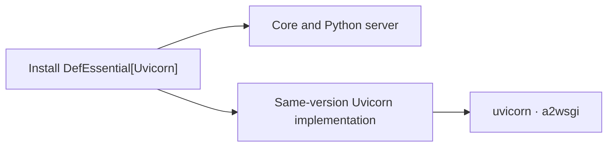

# Installation isolation, development and distribution

[한국어](./Packaging.md) · [Guide index](./README.en.md)

## Installed files

`DefEssential` contains only the core and built-in Python server. The `Gunicorn` and `Uvicorn` extras install the same-version `DefEssential-Gunicorn` and `DefEssential-Uvicorn` distributions and their external dependencies. Existing Python import paths remain unchanged.

In a new environment, unselected adapter files are absent. Omitting an extra later does not remove an installed adapter; explicitly uninstall its implementation distribution when no longer needed.



## Migrate an existing environment

Installing over the old integrated distribution can create overlapping file ownership. Prefer a new virtual environment. Otherwise remove the old distributions first and select the extras you use:

```shell
python -m pip uninstall DefEssential DefEssential-Gunicorn DefEssential-Uvicorn
python -m pip install "DefEssential[Uvicorn]"
python -m pip check
```

To roll back, first remove the new distributions, then reinstall the explicit integrated version previously used.

## Local editable development

Run these commands from the repository root in a development virtual environment. No manually created junctions or symbolic links are needed. Every invocation refreshes metadata and links from the current local sources.

```shell
python -m pip install -e .
```

Omitting the option clears the previous selection and leaves only the core. Select implementations with `EXTRAS`; the commands are identical on Windows and POSIX shells:

```shell
python -m pip install -e . --config-settings EXTRAS=Uvicorn
python -m pip install -e . --config-settings EXTRAS=Gunicorn,Uvicorn
```

Each command replaces, rather than accumulates, the selection. Names are case-insensitive; unknown names fail. Editable installs ignore a leftover `DEF_BUILD_TARGET`. They do not fetch remote source changes, force dependency upgrades, or uninstall external libraries removed from the selection.

When switching from an older split editable or regular installation, remove the old distributions once before reinstalling. The new editable core distribution owns all selected code and must not coexist with standalone implementation distributions:

```shell
python -m pip uninstall DefEssential DefEssential-Gunicorn DefEssential-Uvicorn
python -m pip install -e . --config-settings EXTRAS=Gunicorn,Uvicorn
python -m pip check
```

Editable installs link only core and installed implementation files under the environment's `site-packages/__editable_defessential_view/` and expose that directory through a path-based `.pth`. IDEs can traverse the same tree without import hooks. Python checks installed metadata and link state at startup and updates the tree when necessary. Different environments sharing one source tree keep independent selections.

No separate core-first installation is needed. After adding files or changing package configuration, repeat the command with the desired `EXTRAS`. The managed link tree no longer depends on `build/`. Windows uses file symlinks when permitted and hard links otherwise; hard links require the sources and environment to be on the same volume.

Standard extras in `pip install -e ".[Uvicorn]"` select external dependencies only. Use `--config-settings EXTRAS=Uvicorn` to select implementation code. Regular `pip install "DefEssential[Uvicorn]"` still installs a separate implementation wheel.

Restart the language server after migration. No IDE-specific search paths or diagnostic suppression are needed. Regular wheels do not contain the link-management code. The local backend declared in `pyproject.toml` handles `EXTRAS` in editable hooks without invoking pip recursively or directly modifying the environment.

## Build and validate

One `src` and one `setup.py` serve all distributions. `DEF_BUILD_TARGET` accepts `core`, `Gunicorn` or `Uvicorn`, defaults to `core`, and rejects unknown values.

Build and validate all distributions from the repository root:

```shell
python -m pip install "pip>=23" build "setuptools>=77" "setuptools-scm>=8,<10" wheel twine
python scripts/build_distributions.py
python scripts/check_distributions.py --editable
python -m twine check --strict dist/*
```

The build script fixes the version once, then creates each target's wheel and sdist in `dist/`. Use an output directory without other versions' artifacts. `--outdir` selects another directory; `--wheel` builds only wheels.

Each sdist includes `.distribution-target`, so `python -m build` recreates the same distribution without a target environment variable. Changing an sdist's target is rejected.

`TargetEggInfo.find_sources()` in `setup.py` maintains the additional build sources included in sdists. No separate `MANIFEST.in` is used. This source list does not install helper scripts into regular wheels.

Sdists contain the shared source tree. Unselected implementation files are excluded from built wheels and installed files; the source archives themselves are not split into isolated source trees.

CI builds and checks supported Python versions. Releases verify every distribution name, version and build number, then publish implementations before the core. Publishing permissions and the PyPI token must cover all distribution names. Local builds do not publish anything.
