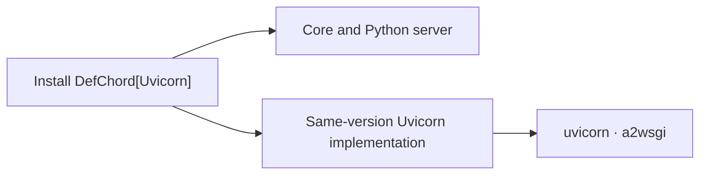

# Installation isolation, development and distribution

[한국어](./Packaging.md) · [Guide index](./README.en.md)

## Installed files

`DefChord` contains only the core and built-in Python server. The `Gunicorn` and `Uvicorn` extras install the same-version `DefChord-Gunicorn` and `DefChord-Uvicorn` distributions and their external dependencies.

Metrics use the `defchord_*` names, and OpenAPI vendor extensions use the `x-defchord-*` keys.

In a new environment, unselected adapter files are absent. Omitting an extra later does not remove an installed adapter; explicitly uninstall its implementation distribution when no longer needed.



## When you want to modify the source code

To fix or add features, use a development installation. An **editable installation** connects Python to your local source code so it can use that code directly.

Download the repository, activate a development virtual environment, and run the following command from the top-level folder containing `setup.py`. Here, `.` means the current folder and `-e` means an editable installation. You need pip 23 or later.

```shell
python -m pip install -e .
```

This connects only the common code and built-in Python server. To also work on the Uvicorn or Gunicorn adapters, list their names in `EXTRAS`. The following commands are separate examples: the first selects Uvicorn only, and the second selects both adapters.

```shell
python -m pip install -e . --config-settings EXTRAS=Uvicorn
python -m pip install -e . --config-settings EXTRAS=Gunicorn,Uvicorn
```

Each run replaces the selection. For example, running with `EXTRAS=Uvicorn` after selecting both adapters removes the Gunicorn code from the development environment. Running without `EXTRAS` leaves only the common code and built-in Python server. Names are case-insensitive; unknown names produce an error. Required external libraries are installed, but libraries for deselected adapters are not automatically removed.

### Try your changes

1. Edit the code under `src/`.
2. Start your application or tests again in the same virtual environment to check the result. Code in an already running program is not automatically reloaded.
3. If you add files or change the installation configuration, repeat the installation command with the desired `EXTRAS`.

The command connects the sources already on your computer. It does not fetch remote changes or force upgrades of external libraries. To select source code, use `--config-settings EXTRAS=Uvicorn` as shown above, not `pip install -e ".[Uvicorn]"`.

### How the development connection works

Only selected code is connected to the environment, and your IDE can find it too. Connections are managed automatically; you do not need to create links or add IDE search paths. Restart the language server if the IDE does not find the installed code right away. Multiple environments sharing the same sources keep their selections separate.

Refresh keeps unchanged file connections and atomically replaces each changed connection. It removes only deselected managed files and preserves other files such as `.DS_Store`. Switching all files simultaneously is not guaranteed.

If creating a connection fails, resolve the cause and repeat the installation command with the desired `EXTRAS`. The next refresh also reconciles files added before the failure with your selection.

Each file's old bytecode cache is removed before replacing its connection. If a later connection fails, retrying therefore does not leave an already replaced file using stale cached code.

On Windows, hard links are used if symbolic-link permissions are unavailable. In that case, keep the sources and virtual environment on the same drive. This connection management applies only to development installations, not regular wheel installations.

## Build and validate

Installation checks explicitly select the locally built core and implementation wheels. Same-version files from PyPI cannot replace those validation artifacts; external dependencies still come from the package index.

Build and validate all distributions from the repository root:

```shell
python -m pip install "pip>=23" build "setuptools>=77" "setuptools-scm>=8,<10" wheel twine
python .github/scripts/build_distributions.py
python .github/scripts/check_distributions.py --editable
python -m twine check --strict dist/*
```

The build script fixes the version once, then creates each target's wheel and sdist in `dist/`. Use an output directory without other versions' artifacts. `--outdir` selects another directory; `--wheel` builds only wheels.

Each sdist includes `.distribution-target`, so `python -m build` recreates the same distribution without a target environment variable. Changing an sdist's target is rejected.

`TargetEggInfo.find_sources()` in `setup.py` maintains the additional build sources included in sdists. No separate `MANIFEST.in` is used. This source list does not install helper scripts into regular wheels.

Sdists contain the shared source tree. Unselected implementation files are excluded from built wheels and installed files; the source archives themselves are not split into isolated source trees.

CI builds and checks supported Python versions. Releases verify every distribution name, version and build number, then publish implementations before the core. Publishing permissions and the PyPI token must cover all distribution names. Local builds do not publish anything.
