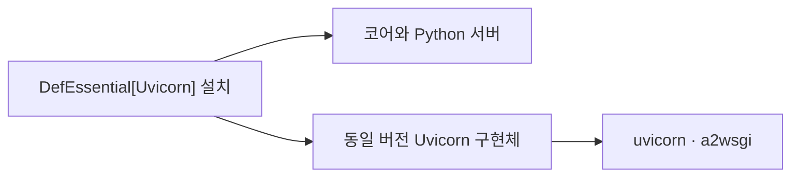

# 설치 격리와 개발·배포

[English](./Packaging.en.md) · [매뉴얼 목차](./README.md)

## 무엇이 설치되는가

`DefEssential`에는 코어와 기본 Python 서버만 포함됩니다. `Gunicorn`과 `Uvicorn` extras는 각각 동일 버전의 `DefEssential-Gunicorn`, `DefEssential-Uvicorn` 배포물과 해당 외부 의존성을 설치합니다. 기존 Python import 경로는 유지합니다.

새 환경에서 선택하지 않은 어댑터 파일은 설치되지 않습니다. 이미 설치한 어댑터는 나중에 extra를 생략해도 제거되지 않으므로, 필요 없다면 해당 구현체 배포물을 명시적으로 제거하세요.



## 기존 환경 전환

이전 통합 배포물과 새 구현체 배포물을 덮어 설치하면 같은 파일을 서로 소유할 수 있습니다. 새 가상환경 사용을 권장합니다. 기존 환경에서는 다음과 같이 제거 후 실제 사용할 extra를 선택하세요.

```shell
python -m pip uninstall DefEssential DefEssential-Gunicorn DefEssential-Uvicorn
python -m pip install "DefEssential[Uvicorn]"
python -m pip check
```

이전 버전으로 되돌릴 때도 새 배포물을 먼저 제거하고, 사용하던 통합 버전을 명시하여 재설치하세요.

## 로컬 editable 개발

아래 명령은 저장소 루트의 개발용 가상환경에서 실행합니다. 정션이나 심볼릭 링크를 직접 만들 필요가 없습니다. 명령마다 현재 로컬 소스로 코어와 선택 구현체의 메타데이터·연결을 갱신합니다.

```shell
python -m pip install -e .
```

옵션을 생략하면 이전 선택도 해제하여 코어만 남깁니다. 구현체를 함께 개발하려면 같은 명령에 `EXTRAS`를 지정하세요. Windows와 POSIX 셸에서 동일합니다.

```shell
python -m pip install -e . --config-settings EXTRAS=Uvicorn
python -m pip install -e . --config-settings EXTRAS=Gunicorn,Uvicorn
```

각 명령은 누적이 아니라 지정한 목록으로 교체합니다. 이름은 대소문자를 구분하지 않으며 잘못된 이름은 오류입니다. 남아 있는 `DEF_BUILD_TARGET`은 editable에서 무시합니다. 원격 소스를 가져오거나 외부 라이브러리를 강제 업그레이드하지는 않으며, 선택에서 빠진 외부 라이브러리는 자동 삭제하지 않습니다.

이전 코어·구현체 분리 editable 또는 일반 설치에서 처음 전환할 때는 기존 배포물을 한 번 제거한 뒤 위 명령으로 설치하세요. 새 editable은 코어 배포물 하나가 선택 코드를 소유하므로 별도 구현체 배포물과 섞으면 오류가 발생합니다.

```shell
python -m pip uninstall DefEssential DefEssential-Gunicorn DefEssential-Uvicorn
python -m pip install -e . --config-settings EXTRAS=Gunicorn,Uvicorn
python -m pip check
```

editable 설치는 가상환경의 `site-packages/__editable_defessential_view/`에 코어와 설치된 구현체의 파일만 링크하고, 이 경로를 `.pth`에 기록합니다. IDE는 import hook 없이 같은 파일 트리를 탐색할 수 있습니다. Python 시작 시 설치 메타데이터와 링크 상태를 확인하고 변경된 구성을 반영합니다. 두 가상환경이 같은 소스를 사용해도 선택 구성은 섞이지 않습니다.

코어를 먼저 별도로 설치할 필요가 없습니다. 새 파일 추가나 패키지 구성 변경 후에는 원하는 `EXTRAS`를 포함해 같은 명령을 다시 실행하세요. 링크 트리는 자동 관리되며 `build/`에 의존하지 않습니다. Windows에서는 파일 심볼릭 링크를 우선 사용하고 권한이 없으면 하드 링크를 사용합니다. 후자는 소스와 가상환경이 같은 볼륨에 있어야 합니다.

`pip install -e ".[Uvicorn]"`의 표준 extras는 외부 의존성만 선택하므로 구현체 코드 선택에는 반드시 `--config-settings EXTRAS=Uvicorn`을 사용하세요. 일반 배포의 `pip install "DefEssential[Uvicorn]"`은 기존대로 별도 구현체 wheel을 설치합니다.

전환 후 Language Server를 재시작하세요. IDE 전용 검색 경로나 경고 숨김은 필요하지 않습니다. 일반 wheel 설치에는 링크 관리 코드가 포함되지 않습니다. `pyproject.toml`의 로컬 백엔드는 editable 훅의 `EXTRAS`만 해석하며 pip를 중첩 호출하거나 가상환경을 직접 수정하지 않습니다.

## 빌드와 검증

하나의 `src`와 `setup.py`를 공유하며 `DEF_BUILD_TARGET`은 `core`, `Gunicorn`, `Uvicorn` 중 하나입니다. 미지정 시 `core`이며, 알 수 없는 값은 오류입니다.

저장소 루트에서 전체 배포물을 빌드·검사합니다.

```shell
python -m pip install "pip>=23" build "setuptools>=77" "setuptools-scm>=8,<10" wheel twine
python scripts/build_distributions.py
python scripts/check_distributions.py --editable
python -m twine check --strict dist/*
```

빌드 스크립트는 버전을 한 번 확정하고 대상별 wheel과 sdist를 `dist/`에 만듭니다. 다른 버전의 산출물이 섞이지 않은 출력 디렉터리를 사용하세요. `--outdir`로 별도 위치를 선택할 수 있고 `--wheel`은 wheel만 만듭니다.

각 sdist에는 `.distribution-target`이 포함되어, 별도의 환경변수 없이 `python -m build`로 재빌드해도 같은 배포물을 만듭니다. sdist의 대상을 바꾸는 것은 허용하지 않습니다.

빌드에 필요한 보조 소스의 sdist 포함 목록은 `setup.py`의 `TargetEggInfo.find_sources()`에서 관리합니다. 별도의 `MANIFEST.in`은 사용하지 않으며, 이 목록은 일반 wheel에 보조 스크립트를 설치하는 설정이 아닙니다.

sdist는 공통 소스 트리를 포함합니다. 선택하지 않은 구현체의 파일을 제외하는 경계는 빌드된 wheel과 최종 설치 파일이며, sdist 원본 소스의 배포까지 분리하는 구조는 아닙니다.

CI는 지원 Python별 빌드·설치 검사를 수행하며, 릴리즈에서는 모든 배포물의 이름·버전·빌드 번호를 확인하고 구현체를 먼저, 코어를 나중에 게시합니다. 게시 권한과 PyPI 토큰은 모든 배포 이름을 지원해야 합니다. 로컬 빌드는 게시를 수행하지 않습니다.
