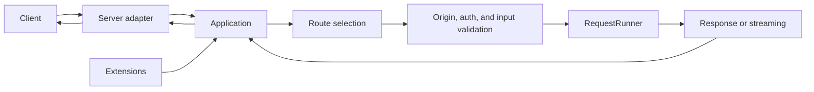

# DefEssential Detailed Guide

[한국어](./README.md)

## What is DefEssential?

DefEssential is a synchronous web framework that handles HTTP requests with ordinary Python methods. Declare a method and path on a `RequestRunner`, register it with an `Application`, and a selected server adapter dispatches requests to the handler. Build request validation, responses, streaming, and WebSocket handling without coroutine-based `async def` or `await`.

Declare routes and input validation separately from application logic. Path parameters, query strings, headers, and request bodies can be converted by validators and content readers. Return an ordinary response object or write directly to a stream. The built-in Python server is included; Gunicorn and Uvicorn adapters are optional extras.

## Request processing architecture

`Application` owns routes and extensions. For each request it creates a handler instance, validates input, then calls `run(request)`. Application and extension hooks handle cross-cutting startup/cleanup and request/response processing; `RequestRunner` hooks handle route-specific behavior. The separate Error Handling guide explains how to build error responses.

## Learning path

1. Start with [Installation and your first application](./GettingStarted.en.md).
2. Learn routing, request validation, authentication, Origin, and ordinary JSON/text/file responses in [Routes, Requests, and Responses](./RoutingAndRequests.en.md).
3. Learn the four ordinary/chunked streaming input and output modes, SSE, and WebSocket in [Streaming and WebSockets](./StreamingAndWebSockets.en.md).
4. Explore health checks, metrics, OpenAPI, file serving, and server adapters in [Extensions and servers](./ExtensionsAndServers.en.md).
5. Learn startup, cleanup, and normal request/response hook timing in [Application lifecycle](./Lifecycle.en.md).
6. See [Error handling](./ErrorHandling.en.md) for error-hook return contracts and layered recovery.

## Guides

- [Installation isolation, development and distribution](./Packaging.en.md): optional implementation files, migration, editable installation and multi-distribution builds
- [Installation and your first application](./GettingStarted.en.md): installation, core components, server startup, and verification
- [Routes, Requests, and Responses](./RoutingAndRequests.en.md): methods and paths, input validation, body readers, authentication, Origin, ordinary responses, and files
- [Streaming and WebSockets](./StreamingAndWebSockets.en.md): four streaming input/output modes, Server-Sent Events, and WebSocket
- [Extensions and server adapters](./ExtensionsAndServers.en.md): built-in extensions, handler module loading, and Python/Gunicorn/Uvicorn
- [Application lifecycle](./Lifecycle.en.md): application and extension startup/cleanup, and normal request/response hook scopes and order
- [Error handling](./ErrorHandling.en.md): `Optional[Response]` error-hook contracts, exception propagation, and operational constraints

## Further resources

See the [README](../README.en.md) for the project overview and minimal example, and [`samples/Sample.py`](../samples/Sample.py) for a runnable sample combining features. The repository test command is in [Installation and your first application](./GettingStarted.en.md#repository-sample-and-tests).
