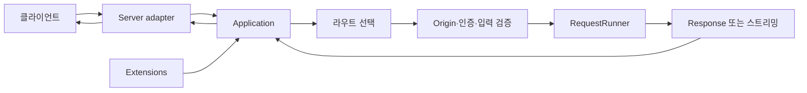

# DefChord 상세 매뉴얼

[English](./README.en.md)

## DefChord란?

DefChord는 일반 Python 메서드로 HTTP 요청을 처리하는 동기식 웹 프레임워크입니다. `RequestRunner`에 메서드와 경로를 선언하고 `Application`에 등록하면, 선택한 server adapter가 받은 요청을 해당 handler로 전달합니다. 코루틴의 `async def`나 `await` 없이 요청 검증, 응답 반환, 스트리밍 및 WebSocket 처리를 구성할 수 있습니다.

라우팅과 입력 검증은 애플리케이션 로직과 별도로 선언합니다. 경로 매개변수, 쿼리 문자열, 헤더와 요청 본문은 검증기와 콘텐츠 리더를 통해 변환할 수 있고, 응답은 일반 객체 또는 직접 출력 스트림으로 제공됩니다. 기본 Python 서버가 포함되며 Gunicorn과 Uvicorn adapter는 선택형 extra로 설치합니다.

## 요청 처리 구조

`Application`은 routes와 extensions를 소유합니다. 각 요청에서 handler 인스턴스를 생성하고 검증한 뒤 `run(request)`를 호출합니다. 요청 전체의 시작·정리와 공통 전처리·후처리는 application/extension 훅으로, route별 동작은 `RequestRunner` 훅으로 분리할 수 있습니다. 오류 응답을 구성하는 방법은 별도 오류 처리 매뉴얼에서 설명합니다.

## 학습 순서

1. 처음 실행할 독자는 [설치와 첫 애플리케이션](./GettingStarted.md)부터 시작하세요.
2. 경로 매칭, 요청 검증, 인증·Origin부터 일반 JSON·텍스트·파일 응답까지는 [라우트와 요청, 응답](./RoutingAndRequests.md)을 참고하세요.
3. 일반·chunked 스트리밍 입력과 출력, SSE, WebSocket은 [스트리밍 처리와 WebSocket](./StreamingAndWebSockets.md)에서 다룹니다.
4. Health check, Metrics, OpenAPI, 파일 제공 및 서버 adapter는 [확장과 서버 어댑터](./ExtensionsAndServers.md)를 확인하세요.
5. startup·cleanup과 정상 요청·응답 훅의 시점은 [애플리케이션 생명주기](./Lifecycle.md)를 참고하세요.
6. 오류 훅의 반환 계약과 계층별 복구 흐름은 [오류 처리](./ErrorHandling.md)에서 확인하세요.

## 매뉴얼 목록

- [설치 격리와 개발·배포](./Packaging.md): 선택 구현체 설치, 소스 코드 직접 수정과 배포 파일 빌드
- [설치와 첫 애플리케이션](./GettingStarted.md): 설치, 네 가지 핵심 구성 요소, 서버 실행 및 첫 요청 검증
- [라우트와 요청, 응답](./RoutingAndRequests.md): HTTP 메서드·경로, 입력 검증, 본문 리더, 인증·Origin, 일반 응답 및 파일 응답
- [스트리밍 처리와 WebSocket](./StreamingAndWebSockets.md): 스트리밍 입력·출력 4가지 방식, Server-Sent Events, WebSocket
- [확장과 서버 어댑터](./ExtensionsAndServers.md): 기본 확장, handler 모듈 로딩, Python·Gunicorn·Uvicorn 선택
- [애플리케이션 생명주기](./Lifecycle.md): application과 extension의 시작·정리, 정상 요청·응답 훅의 범위와 순서
- [오류 처리](./ErrorHandling.md): 오류 훅의 `Optional[Response]` 계약, 예외 전파와 운영상 제약

## 추가 자료

프로젝트 소개와 짧은 예제는 [README](../README.md), 여러 기능을 함께 사용하는 runnable sample은 [`samples/Sample.py`](../samples/Sample.py)를 참고하세요. 저장소 테스트는 [설치와 첫 애플리케이션](./GettingStarted.md#저장소-샘플과-테스트) 절에서 안내합니다.
