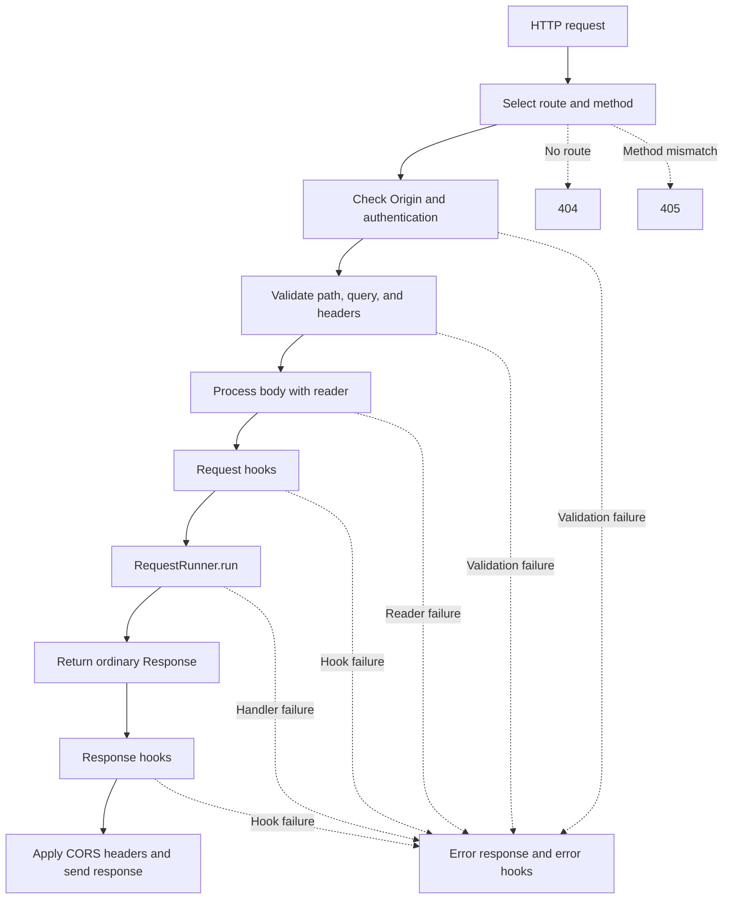

# Routes, Requests, and Responses

[← Guide index](./README.en.md)

[한국어](./RoutingAndRequests.md)

A route connects an HTTP method and URL path to a `RequestRunner`. Validation contracts are declared on the handler class, so inputs can be transformed or rejected before application logic runs.

## Define a route by method and path

Specify `method` and `url` together. A URL must be a path beginning with `/`; it cannot contain a query string or fragment. Declare a path parameter with the `:name` syntax.

```python
from DefEssential import Request, RequestRunner
from DefEssential.Responses import ResponseJSON


class ReadProduct(
  RequestRunner,
  method='GET',
  url='/products/:product_id',
):
  def run(self, request: Request):
    return ResponseJSON({
      'product_id': request.parameters['product_id'],
    })
```

For `GET /products/abc`, the path parameter is the string `'abc'` by default. Add a validator with `Parameters` to convert it; the converted value is available from `request.parameters`. Registering two different handlers for the same method and path raises an error.

`Application` matches the route path and selects a handler. A missing path returns 404; a matching path with no matching method returns 405. `OPTIONS` can be answered automatically from registered route information.

Static paths are checked before parameterized paths. For example, if `/products/search` and `/products/:product_id` are both registered, `GET /products/search` selects the static handler. The same method and URL cannot be registered to two handlers.

## Validate and convert input

Configure validation for each request location through `RequestRunner` class options:

| Option | Input location | Access after processing |
| --- | --- | --- |
| `parameters` | URL path parameters | `request.parameters` |
| `qs` | Query string | `request.qs` |
| `headers` | HTTP headers | `request.headers()` / `request.header()` |
| `body` | Request body | `request.body` |
| `auth` | Custom credential contract | `request.session` |
| `origin` | Allowed `Origin` policy | Checked before CORS response policy is applied |

This example converts path and query values to integers and requires them to be positive.

```python
from DefEssential import (
  QueryString,
  Request,
  RequestRunner,
  Parameters,
)
from DefEssential.Responses import ResponseJSON
from DefEssential.Validator.Patterns import IsGreaterThan, ToInteger


class ReadValue(
  RequestRunner,
  method='GET',
  url='/values/:value',
  parameters=Parameters({
    'value': ToInteger(IsGreaterThan(0)),
  }),
  qs=QueryString(
    {'count': ToInteger(IsGreaterThan(0))},
    requires='count',
  ),
):
  def run(self, request: Request):
    return ResponseJSON({
      'value': request.parameters['value'],
      'count': request.qs['count'],
    })
```

`GET /values/12?count=3` returns `{"value": 12, "count": 3}`. A query key occurring multiple times is represented as a list. `requires` marks query keys as mandatory. A validator or converter raising `ValueError` or `TypeError` becomes a request error.

`Headers` uses the same pattern composition and treats header names case-insensitively. Use `requires=` for mandatory headers. After validation, retrieve values with `request.header('Header-Name')`.

## Request bodies and content readers

Body processing requires `Body` and an explicitly selected reader. If a request has a body but no `Content-Type`, processing fails. If the route has no body reader, the application returns 415.

JSON example:

```python
from DefEssential import Body, Content, Request, RequestRunner
from DefEssential.IO.Readers import JavaScriptObjectNotationContentReader
from DefEssential.Responses import ResponseJSON


class CreateItem(
  RequestRunner,
  method='POST',
  url='/items',
  body=Body(
    JavaScriptObjectNotationContentReader(),
    content=Content('application/json'),
  ),
):
  def run(self, request: Request):
    return ResponseJSON({'received': request.body}, status=201)
```

Set the JSON content type when testing with `curl`:

```shell
curl -X POST http://127.0.0.1:8000/items ^
  -H "Content-Type: application/json" ^
  -d "{\"name\":\"pen\"}"
```

`Body` requires a body by default. Set `Body(..., required=False)` for an optional body and check `request.body is None` when no body was sent.

| Reader | Behavior | Considerations |
| --- | --- | --- |
| `JavaScriptObjectNotationContentReader` | Decodes `application/json` into a JSON value | Invalid JSON is a client error |
| `TextContentReader` | Decodes `text/*` using the declared charset | Defaults to UTF-8 when charset is omitted |
| `FormUrlEncodedContentReader` | Decodes URL-encoded forms into a mapping | Repeated fields become lists |
| `ByteStringContentReader` | Reads the body as bytes | The reader processes bytes regardless of content type |

`StreamContentReader` and `ChunkedStreamContentReader` expose large bodies as streams rather than decoding them as ordinary content. Their input contracts are described separately in [Streaming and WebSockets](./StreamingAndWebSockets.en.md).

## Authentication and sessions

Declare authentication by combining `Credentials`, which extracts credentials from a request, with `Authorization`, which validates them and creates a session value, through `Auth`. `RequestRunner` performs authentication before running the handler. On success, the value returned by `Authorization` is stored in `request.session`, where `run()` can use it as user or permission information.

This example extracts a token from an HTTP `Authorization: Bearer ...` header and validates it:

```python
from DefEssential import (
  Auth,
  Authorization,
  ClientError,
  Request,
  RequestRunner,
)
from DefEssential.Credentials import HTTP
from DefEssential.Responses import ResponseJSON


class AccessTokenAuthorization(Authorization):
  def __call__(self, credentials):
    token = credentials.credentials
    if token != 'demo-token':
      raise ClientError('Invalid access token', status=401)
    return {'user_id': 'user-123', 'roles': ['reader']}


class ReadProfile(
  RequestRunner,
  method='GET',
  url='/profile',
  auth=Auth(
    AccessTokenAuthorization(),
    HTTP('Bearer'),
  ),
):
  def run(self, request: Request):
    return ResponseJSON({
      'user_id': request.session['user_id'],
      'roles': request.session['roles'],
    })
```

The fixed token in this example only demonstrates the contract; it is not a substitute for production token validation. In production, validate signatures, expiration, issuer, audience, and required permissions using a trusted identity system. Do not put secrets or real tokens in source code.

`Auth` works as follows:

- `Credentials` extracts credentials from the request. DefEssential provides these built-in extractors and OAuth2 security schemes:

  | Class | Extraction and behavior | Example |
  | --- | --- | --- |
  | `Query(name)` | Extracts a single string value from the named query key. Repeated keys produce 401. | `Query('token')` |
  | `Header(name)` | Extracts a value from the named HTTP header. | `Header('X-API-Key')` |
  | `Cookie(name)` | Parses the `Cookie` header and extracts the named cookie. Malformed cookies produce 401. | `Cookie('session')` |
  | `HTTP(scheme, format=None)` | Splits the `Authorization` header into scheme and credentials. Scheme comparison is case-insensitive; the result is `HTTPAuthorization`. | `HTTP('Bearer')`, `HTTP('Basic')` |
  | `OAuth2Implicit(authorizationUrl=None)` | Uses Bearer header extraction and provides OAuth2 implicit-flow metadata for OpenAPI. | `OAuth2Implicit('/authorize')` |
  | `OAuth2Password(tokenUrl=None, refreshUrl=None)` | Uses Bearer header extraction and provides OAuth2 password-flow metadata for OpenAPI. | `OAuth2Password('/token', '/refresh')` |
  | `OAuth2ClientCredentials(tokenUrl=None)` | Uses Bearer header extraction and provides OAuth2 client-credentials-flow metadata for OpenAPI. | `OAuth2ClientCredentials('/token')` |
  | `OAuth2AuthorizationCode(authorizationUrl=None, tokenUrl=None)` | Uses Bearer header extraction and provides OAuth2 authorization-code-flow metadata for OpenAPI. | `OAuth2AuthorizationCode('/authorize', '/token')` |

  The OAuth2 classes do not perform token issuance, refresh, redirects, or communication with an OAuth server. They inherit Bearer credential extraction from `HTTP` and primarily provide metadata describing an authentication flow in API documentation. Actual token validation and session creation belong to the `Authorization` implementation. Credentials in URLs can be exposed in logs or history, so avoid `Query` unless there is a specific reason.
- Missing or empty credentials produce 401 by default when authentication is required.
- With `optional=True`, a request without credentials continues unauthenticated. Credentials that are present but malformed or invalid still produce an error, even when authentication is optional.
- `Authorization` validates the credentials and returns the session value for the handler. Authentication failures are generally reported with `ClientError`; `Auth(..., error=...)` can replace a `ClientError` raised during authentication with a custom error.
- Authentication identifies the caller. Use session information in the handler or a separate application policy to decide whether the caller may perform a particular operation.

See the [Credentials API](../src/Credentials.py) and [Validators API](../src/Validators.py) for the `Authorization` and `Credentials` contracts and built-in extractors.

## Origin allowlist and CORS

`Origin` checks whether the request's `Origin` header matches an allowlist and applies Cross-Origin Resource Sharing (CORS) headers to the response. A `RequestRunner` can declare one policy or several. With multiple policies, an Origin matching any policy is allowed.

```python
from DefEssential import Origin, Request, RequestRunner
from DefEssential.Responses import ResponseJSON


class ReadPublicData(
  RequestRunner,
  method='GET',
  url='/public-data',
  origin=Origin((
    'https://app.example.com',
    'https://admin.example.com',
  )),
):
  def run(self, request: Request):
    return ResponseJSON({'status': 'ok'})
```

An Origin must match the header value, including its scheme, host, and port. For example, `https://app.example.com`, `http://app.example.com`, and `https://app.example.com:8443` are different Origins. Do not include a path in an Origin entry.

When a policy is configured:

- A regular request is checked before the handler runs. An Origin outside the allowlist receives 403 by default; use `Origin(..., error=...)` to provide a different error for this check.
- A request without an `Origin` header does not match the allowlist and is rejected. This also applies to non-browser clients.
- A response to an allowed request with an `Origin` header receives `Access-Control-Allow-Origin` reflecting that value and `Vary: Origin` for cache separation. A response without an `Origin` header does not receive CORS response headers.
- An `OPTIONS` preflight resolves the route identified by the request path and `Access-Control-Request-Method`. It checks the Origin policy and method, then verifies that requested headers are allowed by that route's authentication, header, and body configuration. A successful preflight returns 204 with the allowed method and headers.
- If the route declares `auth`, the response also includes `Access-Control-Allow-Credentials: true`. When allowing credentialed cross-origin browser requests, restrict the allowlist to trusted Origins.

`Origin(all=True)` allows any Origin. The response reflects the request's Origin instead of `*`; if the route also declares `auth`, browsers are allowed to expose responses to requests containing credentials. Use it only when intentionally exposing public data to every Origin; do not use it for user-specific data or routes requiring authentication.

CORS controls whether a browser may read a cross-origin response; it does not prove the caller's identity or permissions. Non-browser clients can set Origin arbitrarily, so apply authentication and authorization separately for actual access control.

## Request object

The request contains a unique `request.id`, method, URI, path, parameters, query values, headers, body, and session. `request.writer` is available when the server has attached a response writer; accessing it without one raises `RuntimeError`.

## Return an ordinary response

For a typical request/response flow, `RequestRunner.run()` returns a `Response` object. DefEssential provides classes for JSON, text, and file responses.

| Response type | Class | Purpose |
| --- | --- | --- |
| Base response | `Response` | Set status, headers, and bytes or an iterable of bytes directly |
| JSON response | `ResponseJSON` | Serialize a Python value as UTF-8 JSON |
| Text response | `ResponseText` | Encode a string with the selected charset |
| File response | `ResponseFile` | Read and send a file in fixed-size blocks |

```python
from DefEssential import Request, RequestRunner
from DefEssential.Responses import ResponseJSON


class CreateOrder(RequestRunner, method='POST', url='/orders'):
  def run(self, request: Request):
    order = {'id': 'order-123', 'accepted': True}
    return ResponseJSON(
      order,
      status=201,
      headers={'Location': '/orders/order-123'},
    )
```

`ResponseJSON` serializes a value as UTF-8 JSON and defaults to status 200. Values that cannot be serialized as JSON raise `TypeError`. Return a string body with `ResponseText(text, status=..., headers=..., charset='utf-8')`.

```python
from DefEssential import Request, RequestRunner
from DefEssential.Responses import ResponseText


class PlainText(RequestRunner, method='GET', url='/message'):
  def run(self, request: Request):
    return ResponseText(
      'Processing completed.',
      status=200,
      headers={'X-Result': 'complete'},
    )
```

When creating a `Response` directly, pass bytes or an iterable of bytes as the body. Setting `format` sets `Content-Type`; `charset` adds the character encoding. Response header values cannot contain line breaks.

```python
from DefEssential import Request, RequestRunner, Response


class EmptyCreated(RequestRunner, method='POST', url='/empty'):
  def run(self, request: Request):
    return Response(status=201, body=b'')
```

## File responses

`ResponseFile` sends a local path or open file object as the response body. Given a path, it guesses the content type and compression encoding from the extension and reads the file in fixed-size byte chunks.

```python
from DefEssential import Request, RequestRunner
from DefEssential.Responses import ResponseFile


class DownloadReport(RequestRunner, method='GET', url='/reports/latest'):
  def run(self, request: Request):
    return ResponseFile('reports/latest.csv', format='text/csv')
```

Missing or inaccessible files raise a `ClientError` corresponding to 404 or 403. The response body is closed when transmission finishes or fails. Do not construct file paths directly from user input; validate it and constrain paths to an allowed directory.

For an ordinary returned response, response hooks run after `run()` returns and before CORS response headers are applied and the response is sent. Direct streaming, SSE, and WebSocket—where the handler writes to the connection or upgrades the protocol—are covered in [Streaming and WebSockets](./StreamingAndWebSockets.en.md).



For application, extension, and handler request/response hook order, see [Application lifecycle](./Lifecycle.en.md). For error-response flow, see [Error handling](./ErrorHandling.en.md).
