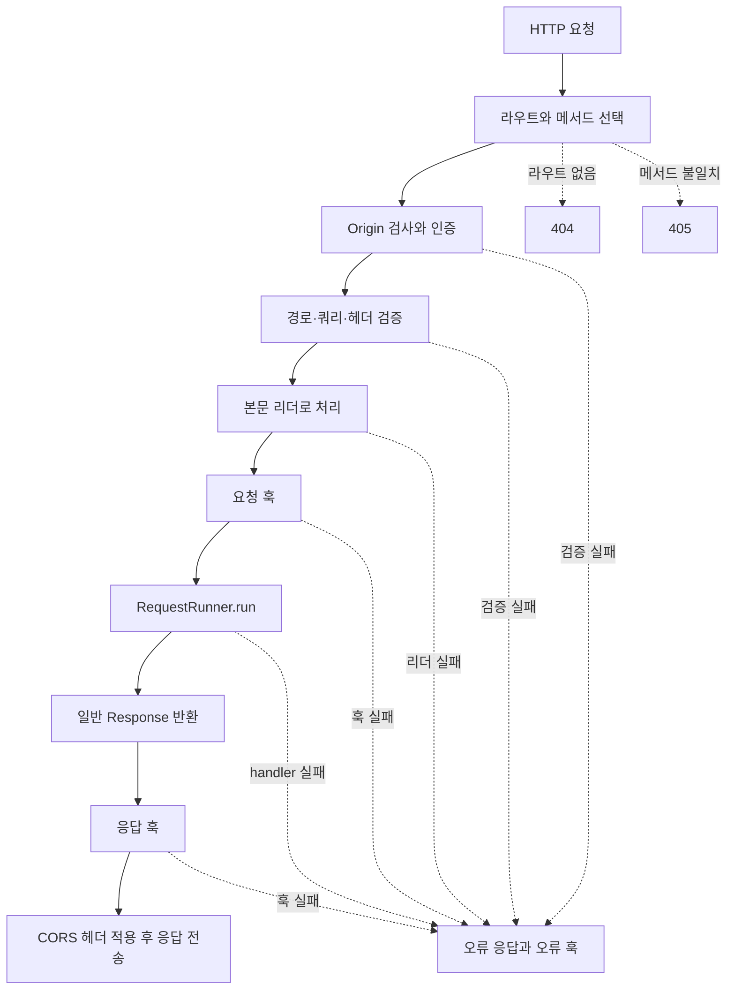

# 라우트와 요청, 응답

[← 매뉴얼 목차](./README.md)

[English](./RoutingAndRequests.en.md)

라우트는 HTTP 메서드와 URL 경로를 `RequestRunner`에 연결합니다. handler 클래스 선언에서 검증 계약도 구성하므로, 요청이 애플리케이션 로직에 도달하기 전에 입력을 변환하거나 거부할 수 있습니다.

## 메서드와 경로로 라우트 만들기

`method`와 `url`은 함께 지정해야 합니다. URL은 `/`로 시작하는 경로이며 쿼리 문자열이나 fragment를 포함하지 않습니다. 경로 변수는 `:name` 형식으로 선언합니다.

```python
from DefEssential import Request, RequestRunner
from DefEssential.Responses import ResponseJSON


class ReadProduct(
  RequestRunner,
  method='GET',
  url='/products/:product_id',
):
  def run(self, request: Request):
    return ResponseJSON({
      'product_id': request.parameters['product_id'],
    })
```

`GET /products/abc` 요청에서 경로 변수는 기본적으로 문자열 `'abc'`입니다. `Parameters`에 검증기를 지정하면 변환된 값이 `request.parameters`에 담깁니다. 같은 메서드와 같은 경로를 서로 다른 handler에 등록하면 오류입니다.

`Application`은 라우트의 경로를 비교해 handler를 선택합니다. 일치하는 경로가 없으면 404, 경로는 일치하지만 메서드가 없으면 405를 돌려줍니다. `OPTIONS` 요청에는 등록된 라우트 정보를 바탕으로 자동 응답할 수 있습니다.

정적 경로가 변수 경로보다 먼저 검사됩니다. 예를 들어 `/products/search` 정적 route와 `/products/:product_id` route를 함께 등록하면 `GET /products/search`는 정적 handler를 선택합니다. 같은 method와 URL을 두 handler에 중복 등록할 수 없습니다.

## 입력값 검증과 변환

`RequestRunner`의 클래스 옵션으로 요청의 서로 다른 위치를 검사합니다.

| 옵션 | 입력 위치 | 처리 후 접근 위치 |
| --- | --- | --- |
| `parameters` | URL 경로 변수 | `request.parameters` |
| `qs` | 쿼리 문자열 | `request.qs` |
| `headers` | HTTP 헤더 | `request.headers()` / `request.header()` |
| `body` | 요청 본문 | `request.body` |
| `auth` | 사용자 정의 자격 증명 | `request.session` |
| `origin` | `Origin` 헤더 허용 정책 | 검사 후 CORS 응답 정책 적용 |

아래 예제는 경로와 쿼리 값을 정수로 바꾸고 양수 조건을 적용합니다.

```python
from DefEssential import (
  QueryString,
  Request,
  RequestRunner,
  Parameters,
)
from DefEssential.Responses import ResponseJSON
from DefEssential.Validator.Patterns import IsGreaterThan, ToInteger


class ReadValue(
  RequestRunner,
  method='GET',
  url='/values/:value',
  parameters=Parameters({
    'value': ToInteger(IsGreaterThan(0)),
  }),
  qs=QueryString(
    {'count': ToInteger(IsGreaterThan(0))},
    requires='count',
  ),
):
  def run(self, request: Request):
    return ResponseJSON({
      'value': request.parameters['value'],
      'count': request.qs['count'],
    })
```

`GET /values/12?count=3` 결과는 `{"value": 12, "count": 3}`입니다. 쿼리 키가 여러 번 나타나면 그 값은 목록으로 전달됩니다. `requires`는 필수 쿼리 키를 지정합니다. 검증기 또는 변환기가 `ValueError`·`TypeError`를 발생시키면 요청 오류로 처리됩니다.

`Headers`도 같은 패턴 조합을 사용하며 헤더 이름을 대소문자 구분 없이 처리합니다. 필수 헤더는 `requires=`로 선언할 수 있습니다. 검증 이후 실제 handler가 필요로 하는 값을 `request.header('Header-Name')`으로 조회합니다.

## 요청 본문과 콘텐츠 리더

본문 처리에는 `Body`와 명시적으로 선택한 리더가 필요합니다. 본문이 전송됐는데 `Content-Type`이 없으면 요청 오류가 발생하고, 해당 라우트에 본문 리더가 없으면 415가 반환됩니다.

JSON 예제:

```python
from DefEssential import Body, Content, Request, RequestRunner
from DefEssential.IO.Readers import JavaScriptObjectNotationContentReader
from DefEssential.Responses import ResponseJSON


class CreateItem(
  RequestRunner,
  method='POST',
  url='/items',
  body=Body(
    JavaScriptObjectNotationContentReader(),
    content=Content('application/json'),
  ),
):
  def run(self, request: Request):
    return ResponseJSON({'received': request.body}, status=201)
```

`curl`로 확인할 때 JSON content type을 지정합니다.

```shell
curl -X POST http://127.0.0.1:8000/items ^
  -H "Content-Type: application/json" ^
  -d "{\"name\":\"pen\"}"
```

`Body`는 기본적으로 본문을 필수로 요구합니다. 선택 본문은 `Body(..., required=False)`로 설정하고, 본문이 없을 때 handler에서 `request.body is None`인지 확인합니다.

| 리더 | 처리 방식 | 주의사항 |
| --- | --- | --- |
| `JavaScriptObjectNotationContentReader` | `application/json`을 JSON 값으로 변환 | 잘못된 JSON은 client error |
| `TextContentReader` | `text/*` 본문을 charset을 사용해 문자열로 변환 | charset 생략 시 UTF-8 |
| `FormUrlEncodedContentReader` | URL 인코딩 폼을 key-value 매핑으로 변환 | 반복 필드는 목록 |
| `ByteStringContentReader` | 본문을 bytes로 읽음 | content type에 관계없이 리더가 직접 데이터 읽음 |

대용량 본문을 스트림으로 소비하는 `StreamContentReader`와 `ChunkedStreamContentReader`는 일반 본문 변환과 사용 계약이 다릅니다. 두 입력 방식은 [스트리밍 처리와 WebSocket](./StreamingAndWebSockets.md)에서 별도로 설명합니다.

## 인증과 세션

인증은 자격 증명을 추출하는 `Credentials`와 자격 증명을 검증하고 세션 값을 만드는 `Authorization`을 `Auth`로 결합해 선언합니다. `RequestRunner`가 handler를 실행하기 전에 인증을 수행하며, 검증 성공 시 `Authorization`이 반환한 값이 `request.session`에 저장됩니다. `run()`에서는 이 세션을 사용자나 권한 정보로 사용할 수 있습니다.

다음 예제는 HTTP `Authorization: Bearer ...` 헤더에서 토큰을 추출하고 검증하는 구조를 보여줍니다.

```python
from DefEssential import (
  Auth,
  Authorization,
  ClientError,
  Request,
  RequestRunner,
)
from DefEssential.Credentials import HTTP
from DefEssential.Responses import ResponseJSON


class AccessTokenAuthorization(Authorization):
  def __call__(self, credentials):
    token = credentials.credentials
    if token != 'demo-token':
      raise ClientError('Invalid access token', status=401)
    return {'user_id': 'user-123', 'roles': ['reader']}


class ReadProfile(
  RequestRunner,
  method='GET',
  url='/profile',
  auth=Auth(
    AccessTokenAuthorization(),
    HTTP('Bearer'),
  ),
):
  def run(self, request: Request):
    return ResponseJSON({
      'user_id': request.session['user_id'],
      'roles': request.session['roles'],
    })
```

이 예제의 고정 토큰은 계약을 설명하기 위한 값이며 실제 서비스의 토큰 검증을 대체하지 않습니다. 운영 환경에서는 신뢰하는 인증 시스템에서 서명, 만료, 발급자, 대상과 필요한 권한을 검증하고, 비밀값이나 실제 토큰을 코드에 넣지 마세요.

`Auth`의 처리 방식은 다음과 같습니다.

- `Credentials`는 요청에서 자격 증명을 추출합니다. DefEssential에서 제공하는 기본 추출기와 OAuth2 보안 스키마는 다음과 같습니다.

  | 클래스 | 추출 위치와 동작 | 주요 사용 예 |
  | --- | --- | --- |
  | `Query(name)` | 지정한 쿼리 키에서 단일 문자열 값을 추출합니다. 같은 키가 여러 번 있으면 401 오류입니다. | `Query('token')` |
  | `Header(name)` | 지정한 HTTP 헤더 값을 추출합니다. | `Header('X-API-Key')` |
  | `Cookie(name)` | `Cookie` 헤더를 파싱해 지정한 쿠키 값을 추출합니다. 쿠키 형식이 잘못되면 401 오류입니다. | `Cookie('session')` |
  | `HTTP(scheme, format=None)` | `Authorization` 헤더에서 scheme과 자격 증명을 분리합니다. scheme 비교는 대소문자를 구분하지 않으며 결과는 `HTTPAuthorization`입니다. | `HTTP('Bearer')`, `HTTP('Basic')` |
  | `OAuth2Implicit(authorizationUrl=None)` | Bearer 헤더 추출을 사용하고 OpenAPI에 OAuth2 implicit flow 메타데이터를 제공합니다. | `OAuth2Implicit('/authorize')` |
  | `OAuth2Password(tokenUrl=None, refreshUrl=None)` | Bearer 헤더 추출을 사용하고 OpenAPI에 OAuth2 password flow 메타데이터를 제공합니다. | `OAuth2Password('/token', '/refresh')` |
  | `OAuth2ClientCredentials(tokenUrl=None)` | Bearer 헤더 추출을 사용하고 OpenAPI에 OAuth2 client credentials flow 메타데이터를 제공합니다. | `OAuth2ClientCredentials('/token')` |
  | `OAuth2AuthorizationCode(authorizationUrl=None, tokenUrl=None)` | Bearer 헤더 추출을 사용하고 OpenAPI에 OAuth2 authorization code flow 메타데이터를 제공합니다. | `OAuth2AuthorizationCode('/authorize', '/token')` |

  OAuth2 클래스들은 토큰 발급, 갱신, 리다이렉트 또는 OAuth 서버 통신을 직접 수행하지 않습니다. 이들은 `HTTP`의 Bearer 자격 증명 추출 동작을 상속하고, 주로 API 문서에 인증 흐름을 설명하는 메타데이터를 제공합니다. 실제 토큰 검증과 세션 생성은 `Authorization` 구현의 책임입니다. 인증 정보를 URL에 남기거나 로그에 노출할 수 있으므로 `Query` 방식은 특별한 이유가 없다면 피하세요.
- 추출한 값이 없거나 빈 문자열이면 필수 인증은 기본적으로 401 오류를 발생시킵니다.
- `optional=True`이면 자격 증명이 없는 경우에만 인증 없이 요청을 계속 처리합니다. 제공된 자격 증명이 형식에 맞지 않거나 검증에 실패하면 선택 인증이어도 오류가 발생합니다.
- `Authorization`은 자격 증명을 검증하고 handler가 사용할 세션 값을 반환합니다. 인증 실패는 일반적으로 `ClientError`로 알리며, `Auth(..., error=...)`로 인증 단계의 `ClientError`를 사용자 정의 오류로 바꿀 수 있습니다.
- 인증은 사용자가 누구인지 확인하는 단계입니다. 특정 작업을 허용할지 결정하는 권한 검사는 handler나 별도 애플리케이션 정책에서 세션 정보를 사용해 수행해야 합니다.

`Authorization`과 `Credentials`의 인터페이스 및 기본 추출기는 [Credentials API](../src/Credentials.py)와 [Validators API](../src/Validators.py)를 참고하세요.

## Origin 허용과 CORS

`Origin`은 요청의 `Origin` 헤더가 허용 목록과 일치하는지 검사하고, 응답에 교차 출처 리소스 공유(CORS) 헤더를 적용하는 정책입니다. `RequestRunner`에 단일 정책 또는 여러 정책을 지정할 수 있습니다. 여러 정책을 지정하면 하나라도 일치하는 Origin을 허용합니다.

```python
from DefEssential import Origin, Request, RequestRunner
from DefEssential.Responses import ResponseJSON


class ReadPublicData(
  RequestRunner,
  method='GET',
  url='/public-data',
  origin=Origin((
    'https://app.example.com',
    'https://admin.example.com',
  )),
):
  def run(self, request: Request):
    return ResponseJSON({'status': 'ok'})
```

Origin 값은 scheme, host, port를 포함한 헤더 값과 일치해야 합니다. 예를 들어 `https://app.example.com`과 `http://app.example.com`, `https://app.example.com:8443`은 서로 다른 Origin입니다. 경로를 Origin 목록에 포함하지 마세요.

정책이 설정되면 다음과 같이 처리됩니다.

- 일반 요청은 handler 실행 전에 Origin을 검사합니다. 허용 목록에 없는 Origin은 기본적으로 403 오류를 받으며, `Origin(..., error=...)`로 이 검사의 오류를 바꿀 수 있습니다.
- 정책이 있는 요청에 `Origin` 헤더가 없으면 허용 목록과 일치하지 않으므로 거부됩니다. 이 동작은 브라우저 외 클라이언트 요청에도 적용됩니다.
- 허용된 `Origin`이 있는 응답에는 해당 값을 반영한 `Access-Control-Allow-Origin`과 캐시 분리를 위한 `Vary: Origin`이 추가됩니다. `origin` 정책이 설정된 응답은 `Origin` 헤더가 없는 경우 CORS 응답 헤더를 추가하지 않습니다.
- `OPTIONS` preflight는 요청 경로와 `Access-Control-Request-Method`가 가리키는 라우트를 확인합니다. Origin 정책과 요청 method를 검사하고, 요청한 헤더가 해당 라우트에서 사용하는 인증·헤더·본문 설정에 허용되는지 확인합니다. 통과하면 허용 method와 헤더를 담은 204 응답을 반환합니다.
- 라우트에 `auth`가 설정되어 있으면 응답에 `Access-Control-Allow-Credentials: true`가 추가됩니다. 브라우저에서 인증 정보가 포함된 교차 출처 요청을 허용할 때는 Origin 허용 목록을 신뢰할 출처로 제한하세요.

`Origin(all=True)`는 임의의 Origin을 허용합니다. 응답은 `*` 대신 요청의 Origin 값을 반영하며, 해당 라우트에 `auth`가 설정되어 있으면 인증 정보를 포함한 요청도 브라우저가 응답을 읽을 수 있도록 허용합니다. 공개 데이터처럼 의도적으로 모든 출처에 공개할 경우에만 사용하고, 사용자별 데이터나 인증이 필요한 라우트에는 사용하지 마세요.

CORS는 브라우저가 다른 출처의 응답을 읽을 수 있는지 제어할 뿐, 호출자의 신원이나 권한을 증명하지 않습니다. 비브라우저 클라이언트는 Origin을 임의로 설정할 수 있으므로 실제 접근 제어에는 인증과 권한 검사를 별도로 적용해야 합니다.

## 요청 객체

요청에는 고유한 `request.id`, method, URI, path, 파라미터, 쿼리, 헤더, body, session이 담깁니다. `request.writer`는 서버가 응답 writer를 붙였을 때 사용할 수 있으며 연결이 없는 호출에서는 `RuntimeError`를 발생시킵니다.

## 일반 응답 반환

기본적인 요청/응답 흐름에서는 `RequestRunner.run()`이 `Response` 객체를 반환합니다. DefEssential은 JSON·텍스트·파일 응답을 위한 클래스를 제공합니다.

| 응답 종류 | 클래스 | 사용 목적 |
| --- | --- | --- |
| 기본 응답 | `Response` | 상태 코드, 헤더, bytes 또는 bytes iterable을 직접 지정 |
| JSON 응답 | `ResponseJSON` | Python 값을 UTF-8 JSON으로 직렬화 |
| 텍스트 응답 | `ResponseText` | 문자열을 지정한 charset으로 인코딩 |
| 파일 응답 | `ResponseFile` | 파일을 고정 크기 블록으로 읽어 전송 |

```python
from DefEssential import Request, RequestRunner
from DefEssential.Responses import ResponseJSON


class CreateOrder(RequestRunner, method='POST', url='/orders'):
  def run(self, request: Request):
    order = {'id': 'order-123', 'accepted': True}
    return ResponseJSON(
      order,
      status=201,
      headers={'Location': '/orders/order-123'},
    )
```

`ResponseJSON`은 값을 UTF-8 JSON으로 직렬화하고 기본 상태 코드는 200입니다. JSON으로 직렬화할 수 없는 값은 `TypeError`를 발생시킵니다. 문자열 본문은 `ResponseText(text, status=..., headers=..., charset='utf-8')`로 반환할 수 있습니다.

```python
from DefEssential import Request, RequestRunner
from DefEssential.Responses import ResponseText


class PlainText(RequestRunner, method='GET', url='/message'):
  def run(self, request: Request):
    return ResponseText(
      '처리가 완료되었습니다.',
      status=200,
      headers={'X-Result': 'complete'},
    )
```

직접 `Response`를 생성할 때는 bytes 또는 bytes iterable을 본문으로 전달할 수 있습니다. `format`을 지정하면 `Content-Type`이 설정되며, `charset`은 해당 문자 인코딩을 추가합니다. 응답 헤더 값에는 줄바꿈을 포함할 수 없습니다.

```python
from DefEssential import Request, RequestRunner, Response


class EmptyCreated(RequestRunner, method='POST', url='/empty'):
  def run(self, request: Request):
    return Response(status=201, body=b'')
```

## 파일 응답

`ResponseFile`은 로컬 경로 또는 열린 파일 객체를 응답 본문으로 전송합니다. 경로를 전달하면 확장자를 바탕으로 콘텐츠 형식과 압축 인코딩을 추측하고 파일을 일정 크기의 bytes 단위로 읽습니다.

```python
from DefEssential import Request, RequestRunner
from DefEssential.Responses import ResponseFile


class DownloadReport(RequestRunner, method='GET', url='/reports/latest'):
  def run(self, request: Request):
    return ResponseFile('reports/latest.csv', format='text/csv')
```

파일이 없거나 읽을 수 없으면 `ResponseFile`은 404 또는 403에 해당하는 `ClientError`를 발생시킵니다. 응답 본문은 전송이 끝나거나 실패할 때 닫힙니다. 사용자 입력으로 파일 경로를 직접 조합하지 말고, 입력을 검증하고 허용 디렉터리 안으로 경로를 제한하세요.

일반 반환 응답의 응답 훅은 `run()`이 응답을 반환한 뒤, CORS 응답 헤더와 전송 처리 전에 실행됩니다. 직접 스트리밍, SSE, WebSocket처럼 연결에 직접 기록하거나 프로토콜을 업그레이드하는 방식은 [스트리밍 처리와 WebSocket](./StreamingAndWebSockets.md)에서 다룹니다.



요청 전체의 애플리케이션·확장·handler 요청·응답 훅 순서는 [애플리케이션 생명주기](./Lifecycle.md)를, 오류 응답의 흐름은 [오류 처리](./ErrorHandling.md)를 참고하세요.
