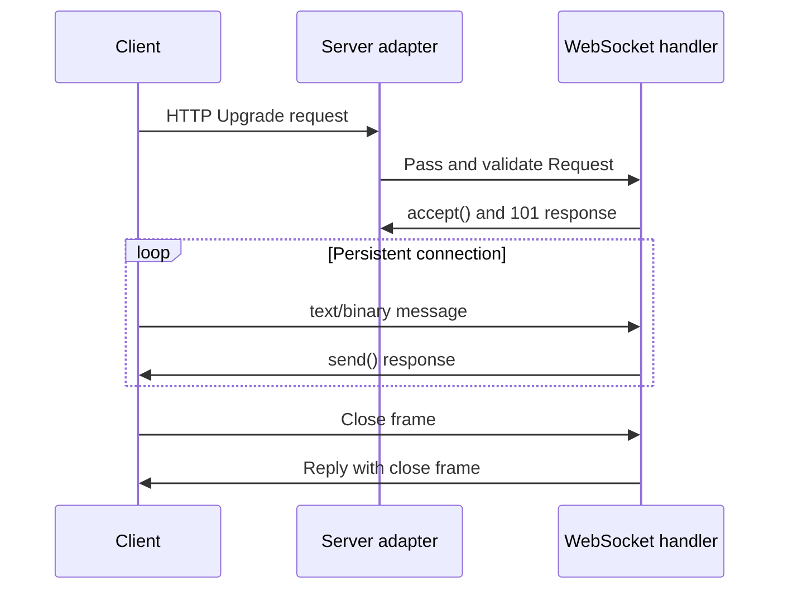

# Streaming and WebSockets

[← Guide index](./README.en.md)

[한국어](./StreamingAndWebSockets.md)

Streaming reads request bodies incrementally or writes response data as it is produced, avoiding buffering the entire payload in memory. DefChord provides separate readers for length-delimited and HTTP chunked input, and separate writers for ordinary and chunked output. SSE and WebSocket are distinct long-lived communication patterns.

| Direction | Mode | API | Transport behavior |
| --- | --- | --- | --- |
| Input | Ordinary stream | `StreamContentReader` | Requires `Content-Length`; does not accept chunked input |
| Input | Chunked stream | `ChunkedStreamContentReader` | Requires HTTP chunked transfer encoding |
| Output | Ordinary stream | `StreamWriter` | Does not use HTTP chunked framing |
| Output | Chunked stream | `ChunkedStreamWriter` | Uses HTTP/1.1 chunked framing |

## Ordinary streaming input

`StreamContentReader` exposes a request body with `Content-Length` as a `RequestReader` without pre-reading it. It does not support chunked transfer encoding; if `Content-Length` is missing, it raises a 411 error.

```python
from DefChord import Body, Content, Request, RequestRunner
from DefChord.IO.Readers import StreamContentReader
from DefChord.Responses import ResponseJSON


class CountUpload(
  RequestRunner,
  method='POST',
  url='/upload',
  body=Body(
    StreamContentReader(),
    content=Content('application/octet-stream'),
  )
):

  def run(self, request: Request):
    total = 0
    while True:
      block = request.body.read(64 * 1024)
      if not block:
        break
      total += len(block)
    return ResponseJSON({'received_bytes': total})
```

`request.body` is a `RequestReader`. Read at most a chosen block size with `read(size)`; an empty bytes value indicates the end of the body. The handler is responsible for consuming and processing the body. Define size limits and processing policies in the application for large inputs.

## Chunked streaming input

`ChunkedStreamContentReader` exposes a request body as a `ChunkedStream` and incrementally decodes data sent with chunked transfer encoding. A request without chunked transfer encoding produces a client error.

```python
from DefChord import Body, Content, Request, RequestRunner
from DefChord.IO.Readers import ChunkedStreamContentReader
from DefChord.Responses import ResponseJSON


class CountChunkedUpload(
  RequestRunner,
  method='POST',
  url='/chunked-upload',
  body=Body(
    ChunkedStreamContentReader(),
    content=Content('application/octet-stream'),
  )
):

  def run(self, request: Request):
    total = 0
    while True:
      block = request.body.read(64 * 1024)
      if not block:
        break
      total += len(block)
    return ResponseJSON({'received_bytes': total})
```

`read(size)` may read across multiple transfer chunks and return up to `size` bytes. `chunk(size)` reads without crossing the current HTTP transfer-chunk boundary. Transfer-chunk boundaries are not guaranteed to match application record boundaries, so frame and parse application records separately.

## Ordinary streaming output

`StreamWriter` starts a response and writes bytes in order. It does not add HTTP chunked framing. The status and headers are fixed by `begin()`; write the body with `write()` and send buffered data with `flush()`.

```python
from DefChord import Request, RequestRunner
from DefChord.IO.Writers import StreamWriter


class PlainStream(RequestRunner, method='GET', url='/stream'):
  def run(self, request: Request) -> None:
    writer = StreamWriter(request.writer)
    writer.begin(format='text/plain', charset='utf-8')
    writer.write(b'first\n')
    writer.flush()
    writer.write(b'second\n')
    writer.end()
    return
```

After starting direct output, the handler must return `None`. It cannot return an ordinary `Response` or change the status and headers. Connections can be interrupted and writes can fail; complete validation before starting the response when possible errors cannot be recovered from after output begins. Check the selected server adapter's contract for completion and connection handling.

## Chunked streaming output

`ChunkedStreamWriter` uses HTTP/1.1 chunked transfer framing. `chunk(data)` writes bytes and flushes so the consumer can receive them progressively. Chunked output is supported only for HTTP/1.1 requests.

```python
from DefChord import Request, RequestRunner
from DefChord.IO.Writers import ChunkedStreamWriter


class ChunkedStreamResponse(RequestRunner, method='GET', url='/chunked-stream'):
  def run(self, request: Request) -> None:
    writer = ChunkedStreamWriter(request.writer)
    writer.begin(format='text/plain', charset='utf-8')
    writer.chunk(b'first\n')
    writer.chunk(b'second\n')
    writer.end()
    return
```

Set the status and headers before `begin()`, and call `end()` after successful completion. A disconnected client cannot receive a replacement status or a rollback of bytes already sent. Verify in the deployment environment whether servers and proxies buffer streaming responses or close idle connections.

## Server-Sent Events

Server-Sent Events (SSE) keep an HTTP connection open while sending UTF-8 text events from the server to the client. SSE does not provide bidirectional client-to-server messaging.

```python
from DefChord import Request, RequestRunner
from DefChord.IO.Writers import ServerSentEventsWriter


class Events(RequestRunner, method='GET', url='/events'):
  def run(self, request: Request) -> None:
    writer = ServerSentEventsWriter(request.writer)
    writer.begin()
    writer.emit(
      '{"status":"ready"}',
      event='status',
      id='1',
      retry=3000,
    )
    writer.comment('keep-alive')
    writer.emit(
      '{"status":"done"}',
      event='status',
      id='2',
    )
    writer.end()
    return
```

`begin()` starts a response with `Content-Type: text/event-stream; charset=utf-8` and `Cache-Control: no-cache` by default. `emit(data, event=..., id=..., retry=...)` encodes an SSE event, writes it, and flushes immediately. `retry(ms)` sends a reconnection interval field, and `end()` finishes output. This example sends a comment between two events and closes the connection; it does not implement a heartbeat interval.

### Comments and keep-alives

`comment(text: str) -> None` prefixes every input line with `: `, adds a final blank line, sends the UTF-8 SSE comment, and flushes immediately. For example, `comment('keep-alive')` sends `b': keep-alive\n\n'`. An empty string sends `b': \n\n'`. CRLF, CR, and LF are normalized to LF, preserving intermediate blank lines and trailing line breaks.

SSE clients ignore comments, so they do not dispatch application events or change the last event ID or reconnection interval. Even when multiline input contains `data:`, `event:`, `id:`, or `retry:`, every line is sent as a comment. The same API works with plain output and the existing chunked output path that accepts a `ChunkedStreamWriter`.

If you need keep-alive heartbeats, configure your application to call `comment('keep-alive')` repeatedly during idle periods. DefChord does not provide a timer or automatic heartbeat scheduler. Call it after `begin()` while output remains open. Write and flush failures propagate to the caller, so use your application's existing error handling.

An immediate flush means flushing the underlying writer; it does not guarantee client receipt, disable proxy buffering, or guarantee that an idle connection stays open. For a persistent connection, design event production, client disconnection, server/proxy timeouts, and reconnection behavior together, and verify them in the deployment environment.

## WebSocket

WebSocket upgrades an HTTP connection into a persistent, bidirectional message channel. Declare the handler as a `RequestRunner` and use `WebSocket` to perform the handshake and exchange messages.

```python
from DefChord import Request, RequestRunner
from DefChord.IO.WebSocket import WebSocket


class Echo(RequestRunner, method='GET', url='/ws'):
  def run(self, request: Request) -> None:
    socket = WebSocket(request, limit=65536)
    socket.accept()
    try:
      while True:
        message = socket.receive()
        if message is None:
          break
        socket.send(message)
    finally:
      socket.close()
    return
```

Register `Echo` with the application and run it with a WebSocket-capable server adapter. Ordinary HTTP request and handler input validation run before the connection is upgraded. `accept()` validates the handshake and sends a 101 response. If the handshake fails, a regular HTTP error can be returned before the upgrade.

- `send(str)` sends a text message; `send(bytes)` sends a binary message. Other types raise `TypeError`.
- `receive()` returns one message and returns `None` when the connection starts closing. Ping frames are automatically answered with Pong.
- The `limit` in `WebSocket(request, limit=...)` is a positive message-size limit. Set it according to the expected message size.
- `socket.close(code=1000, reason='')` sends a close frame and waits for the peer's close frame. The reason is limited to 123 UTF-8 bytes.
- Inspect requested subprotocols with `socket.protocols` and respond with the selected value using `accept(protocol=...)`.
- Call `receive()` from one thread. `send()`, `ping()`, and `close()` can be called from other threads with internal synchronization.



Define message-size limits, authentication, connection counts, idle timeouts, and client-disconnection behavior in the application and deployment environment. Check WebSocket support and limitations in the selected server adapter.
