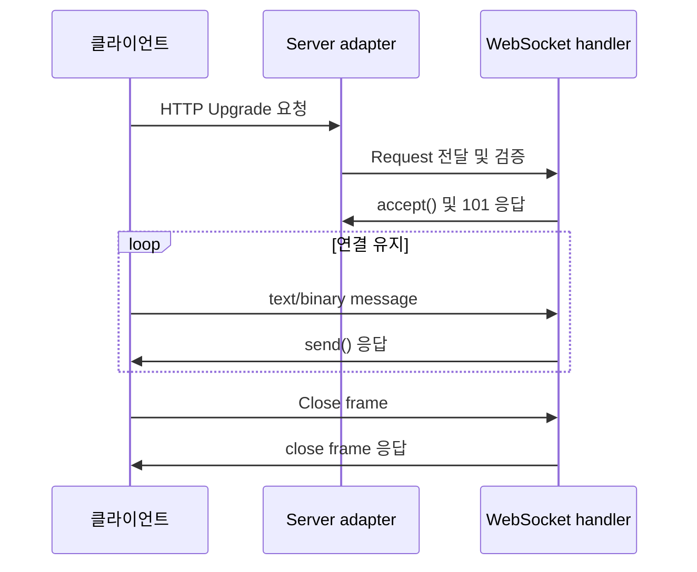

# 스트리밍 처리와 WebSocket

[← 매뉴얼 목차](./README.md)

[English](./StreamingAndWebSockets.en.md)

스트리밍은 요청 본문을 조금씩 읽거나 응답을 생성되는 대로 기록하여 전체 데이터를 메모리에 모으지 않도록 합니다. DefChord는 본문 길이가 지정된 입력 스트림과 HTTP chunked 입력 스트림, 일반 출력 스트림과 chunked 출력 스트림을 각각 제공합니다. SSE와 WebSocket은 연결을 오래 유지하는 별도 통신 방식입니다.

| 방향 | 방식 | API | 전송 특성 |
| --- | --- | --- | --- |
| 입력 | 일반 스트림 | `StreamContentReader` | `Content-Length` 필요, chunked 입력 불가 |
| 입력 | chunked 스트림 | `ChunkedStreamContentReader` | HTTP chunked 전송 필요 |
| 출력 | 일반 스트림 | `StreamWriter` | HTTP chunked framing 미사용 |
| 출력 | chunked 스트림 | `ChunkedStreamWriter` | HTTP/1.1 chunked framing 사용 |

## 일반 스트리밍 입력

`StreamContentReader`는 `Content-Length`가 지정된 요청 본문을 미리 읽지 않고 `RequestReader`로 전달합니다. chunked transfer encoding 입력은 지원하지 않으며 `Content-Length`가 없으면 411 오류가 발생합니다.

```python
from DefChord import Body, Content, Request, RequestRunner
from DefChord.IO.Readers import StreamContentReader
from DefChord.Responses import ResponseJSON


class CountUpload(
  RequestRunner,
  method='POST',
  url='/upload',
  body=Body(
    StreamContentReader(),
    content=Content('application/octet-stream'),
  )
):

  def run(self, request: Request):
    total = 0
    while True:
      block = request.body.read(64 * 1024)
      if not block:
        break
      total += len(block)
    return ResponseJSON({'received_bytes': total})
```

`request.body`는 `RequestReader`입니다. `read(size)`로 정해진 최대 크기씩 읽고 빈 bytes가 반환되면 본문 끝입니다. handler는 모든 본문을 소비하고 처리할 책임이 있습니다. 입력이 큰 경우 크기 제한이나 처리 정책도 애플리케이션에서 정하세요.

## Chunked 스트리밍 입력

`ChunkedStreamContentReader`는 요청 본문을 `ChunkedStream`으로 전달하고 chunked transfer encoding으로 전송된 데이터를 점진적으로 디코딩합니다. 입력에 chunked 전송 표시가 없으면 요청 오류가 발생합니다.

```python
from DefChord import Body, Content, Request, RequestRunner
from DefChord.IO.Readers import ChunkedStreamContentReader
from DefChord.Responses import ResponseJSON


class CountChunkedUpload(
  RequestRunner,
  method='POST',
  url='/chunked-upload',
  body=Body(
    ChunkedStreamContentReader(),
    content=Content('application/octet-stream'),
  )
):

  def run(self, request: Request):
    total = 0
    while True:
      block = request.body.read(64 * 1024)
      if not block:
        break
      total += len(block)
    return ResponseJSON({'received_bytes': total})
```

`read(size)`는 여러 전송 chunk에 걸친 데이터를 읽어 최대 `size` bytes를 반환할 수 있습니다. `chunk(size)`는 현재 HTTP 전송 chunk의 경계를 넘지 않고 데이터를 읽습니다. 전송 chunk 경계는 애플리케이션 레코드 경계와 같다고 보장되지 않으므로, 레코드 형식은 별도로 프레이밍하고 파싱해야 합니다.

## 일반 스트리밍 출력

`StreamWriter`는 응답을 시작한 뒤 bytes를 순서대로 씁니다. HTTP chunked framing은 추가하지 않습니다. 상태 코드와 헤더는 `begin()` 시 확정되며, 본문은 `write()`로 전달하고 `flush()`로 내보낼 수 있습니다.

```python
from DefChord import Request, RequestRunner
from DefChord.IO.Writers import StreamWriter


class PlainStream(RequestRunner, method='GET', url='/stream'):
  def run(self, request: Request) -> None:
    writer = StreamWriter(request.writer)
    writer.begin(format='text/plain', charset='utf-8')
    writer.write(b'first\n')
    writer.flush()
    writer.write(b'second\n')
    writer.end()
    return
```

직접 출력을 시작한 handler는 `None`을 반환해야 합니다. 응답이 시작되면 일반 `Response`를 반환하거나 상태 코드·헤더를 바꿀 수 없습니다. 연결이 중간에 끊기거나 쓰기에 실패할 수 있으므로, 출력 중에 복구할 수 없는 오류가 발생할 가능성을 고려해 응답을 시작하기 전에 필요한 검증을 마치세요. 전송 완료 처리와 연결 종료 방식은 선택한 server adapter의 계약도 확인해야 합니다.

## Chunked 스트리밍 출력

`ChunkedStreamWriter`는 HTTP/1.1 chunked transfer framing을 사용합니다. `chunk(data)`는 bytes를 기록하고 flush하므로 소비자가 데이터를 점진적으로 받을 수 있습니다. chunked 출력은 HTTP/1.1 요청에만 사용할 수 있습니다.

```python
from DefChord import Request, RequestRunner
from DefChord.IO.Writers import ChunkedStreamWriter


class ChunkedStreamResponse(RequestRunner, method='GET', url='/chunked-stream'):
  def run(self, request: Request) -> None:
    writer = ChunkedStreamWriter(request.writer)
    writer.begin(format='text/plain', charset='utf-8')
    writer.chunk(b'first\n')
    writer.chunk(b'second\n')
    writer.end()
    return
```

`begin()` 전에 상태 코드와 응답 헤더를 설정하고, 성공적으로 완료되면 `end()`를 호출하세요. 연결이 끊긴 뒤에는 전송을 되돌리거나 이미 보낸 응답을 다른 상태 코드로 교체할 수 없습니다. 서버와 프록시가 스트리밍 응답을 버퍼링하거나 유휴 연결을 종료하는지 배포 환경에서도 확인하세요.

## Server-Sent Events

Server-Sent Events(SSE)는 HTTP 연결을 유지하며 서버에서 클라이언트로 UTF-8 텍스트 이벤트를 보냅니다. 클라이언트에서 서버로 메시지를 보내는 양방향 통신은 제공하지 않습니다.

```python
from DefChord import Request, RequestRunner
from DefChord.IO.Writers import ServerSentEventsWriter


class Events(RequestRunner, method='GET', url='/events'):
  def run(self, request: Request) -> None:
    writer = ServerSentEventsWriter(request.writer)
    writer.begin()
    writer.emit(
      '{"status":"ready"}',
      event='status',
      id='1',
      retry=3000,
    )
    writer.comment('keep-alive')
    writer.emit(
      '{"status":"done"}',
      event='status',
      id='2',
    )
    writer.end()
    return
```

`begin()`은 `Content-Type: text/event-stream; charset=utf-8`과 기본 `Cache-Control: no-cache`로 응답을 시작합니다. `emit(data, event=..., id=..., retry=...)`는 SSE 형식으로 인코딩한 이벤트를 쓰고 즉시 flush합니다. `retry(ms)`는 재연결 간격 필드를 전송하며, `end()`는 출력을 끝냅니다. 위 예제는 두 이벤트 사이에 주석을 보낸 뒤 연결을 닫으며, 주석 전송 주기를 구현한 예제는 아닙니다.

### 주석 전송과 연결 유지

`comment(text: str) -> None`은 모든 입력 줄 앞에 `: `를 붙이고 마지막에 빈 줄을 추가해 UTF-8 SSE 주석을 전송한 뒤 즉시 flush합니다. 예를 들어 `comment('keep-alive')`는 `b': keep-alive\n\n'`를 전송합니다. 빈 문자열도 `b': \n\n'`로 전송하며 CRLF·CR·LF를 LF로 정규화하고 중간 빈 줄과 마지막 줄바꿈을 보존합니다.

SSE 클라이언트는 주석을 무시하므로 업무 이벤트가 발생하지 않고 마지막 이벤트 ID와 재연결 간격도 바뀌지 않습니다. 여러 줄 입력에 `data:`·`event:`·`id:`·`retry:`가 있더라도 각 줄은 주석으로 전송됩니다. 일반 출력과 `ChunkedStreamWriter`를 전달하는 기존 chunked 출력에서 같은 API를 사용할 수 있습니다.

연결 유지용 heartbeat가 필요하면 애플리케이션이 유휴 시간에 `comment('keep-alive')`를 반복 호출하도록 구성하세요. DefChord는 타이머나 자동 heartbeat 스케줄러를 제공하지 않습니다. `begin()` 이후 출력이 열려 있는 동안 호출하고, write·flush 실패는 호출자에게 전파되므로 애플리케이션의 기존 오류 처리 흐름을 따르세요.

즉시 flush는 하위 writer를 flush한다는 뜻이며 클라이언트 수신, 프록시 버퍼링 해제나 유휴 연결 유지 성공을 보장하지 않습니다. 지속 연결을 구성할 때는 이벤트 생산, 클라이언트 연결 종료, 서버·프록시 시간 제한과 재연결 동작을 함께 설계하고 배포 환경에서 확인하세요.

## WebSocket

WebSocket은 HTTP 연결을 업그레이드해 클라이언트와 서버가 양방향 메시지를 주고받는 지속 연결 프로토콜입니다. handler는 `RequestRunner`로 선언하고 `WebSocket` 객체에서 handshake와 메시지를 처리합니다.

```python
from DefChord import Request, RequestRunner
from DefChord.IO.WebSocket import WebSocket


class Echo(RequestRunner, method='GET', url='/ws'):
  def run(self, request: Request) -> None:
    socket = WebSocket(request, limit=65536)
    socket.accept()
    try:
      while True:
        message = socket.receive()
        if message is None:
          break
        socket.send(message)
    finally:
      socket.close()
    return
```

애플리케이션에 `Echo` handler를 등록하고 WebSocket을 지원하는 server adapter로 실행하세요. 연결이 업그레이드되기 전에 일반 HTTP 요청 및 handler 입력 검증이 수행됩니다. `accept()`는 handshake를 검증하고 101 응답을 보냅니다. handshake가 실패하면 업그레이드 전에 일반 HTTP 오류를 반환할 수 있습니다.

- `send(str)`는 text message를, `send(bytes)`는 binary message를 보냅니다. 다른 형식은 `TypeError`입니다.
- `receive()`는 메시지 하나를 반환하고 연결 종료가 시작되면 `None`을 반환합니다. Ping frame에는 자동으로 Pong을 보냅니다.
- `WebSocket(request, limit=...)`의 `limit`은 메시지 크기 상한이며 양수여야 합니다. 예상 메시지 크기에 맞춰 제한을 설정하세요.
- `socket.close(code=1000, reason='')`는 close frame을 보내고 상대의 close frame을 기다립니다. reason은 UTF-8 인코딩 기준 최대 123 bytes입니다.
- `socket.protocols`에서 handshake에 요청된 subprotocol을 확인하고, 선택한 값은 `accept(protocol=...)`으로 응답할 수 있습니다.
- `receive()`는 한 스레드에서 호출해야 합니다. `send()`, `ping()`, `close()`는 내부 동기화로 다른 스레드에서도 호출할 수 있습니다.



메시지 크기, 인증, 연결 수, 유휴 연결 만료와 클라이언트 연결 종료 정책을 애플리케이션 및 배포 환경에서 정하세요. 선택한 server adapter의 WebSocket 지원 여부와 제한도 확인해야 합니다.
